# Module 03 — OOP with TypeScript

*Beginner to Intermediate · Object-Oriented Programming*

**Level:** Beginner to Intermediate  
**Category:** TypeScript / Programming Fundamentals  
**Module:** 03  
**Status:** In Progress

**Learn Deeply. Build Practically. Explain Clearly.**

This module introduces Object-Oriented Programming (OOP) using TypeScript. You will learn classes, objects, encapsulation, inheritance, polymorphism, and abstraction. You will then apply these ideas by building a small UI system called MiniDOM and explore utility classes.

Each lesson includes a simple explanation, a picture, a Mermaid diagram, practical TypeScript code, interview questions, and exercises.

---

## Table of Contents

- [Learning Objectives](#learning-objectives)
- [Your Learning Workflow](#your-learning-workflow)
- [3-1. What Is OOP?](#3-1-what-is-oop)
- [3-2. Class and Object](#3-2-class-and-object)
- [3-3. Encapsulation](#3-3-encapsulation)
- [3-4. Inheritance](#3-4-inheritance)
- [3-5. Inheritance Continued](#3-5-inheritance-continued)
- [3-6. Polymorphism](#3-6-polymorphism)
- [3-7. Abstraction](#3-7-abstraction)
- [3-8. Fun with OOP — MiniDOM Part 1](#3-8-fun-with-oop--minidom-part-1)
- [3-9. Fun with OOP — MiniDOM Part 2](#3-9-fun-with-oop--minidom-part-2)
- [3-10. Utility Classes](#3-10-utility-classes)
- [3-11. Closing Words](#3-11-closing-words)
- [Module Review](#module-review)
- [Final Module Challenge](#final-module-challenge)
- [Recommended Resources](#recommended-resources)

---

## Learning Objectives

By completing this module, you should be able to:

- Explain Object-Oriented Programming in simple language.
- Understand the difference between a class and an object.
- Use encapsulation to protect data.
- Apply inheritance to reuse and extend code.
- Understand polymorphism and method overriding.
- Use abstraction with abstract classes and methods.
- Build simple UI-related examples using OOP.
- Understand composition through the MiniDOM project.
- Create helper methods using static utility classes.
- Explain OOP concepts in technical interviews.

---

## Your Learning Workflow

Use the same process for every topic.

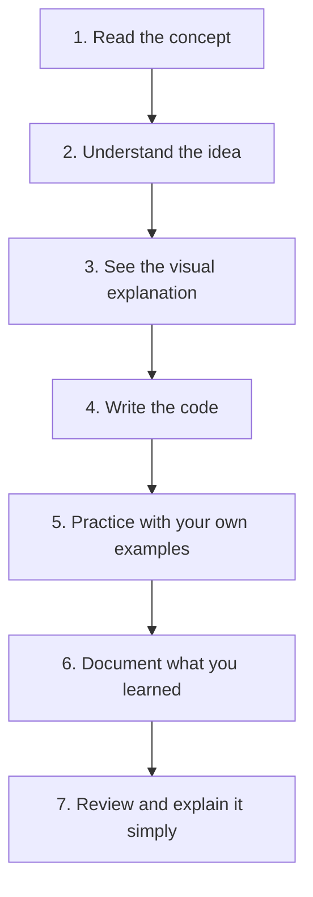

1. **Read:** Read the topic and understand the main idea.
2. **Understand:** Ask what it is, why it is useful, and when to use it.
3. **Visualize:** Study the picture and Mermaid diagram.
4. **Implement:** Type and run the code yourself.
5. **Practice:** Change the example and test different cases.
6. **Document:** Write down important ideas and mistakes.
7. **Review:** Explain the topic without reading the notes.

---

# 3-1. What Is OOP?

*Beginner · OOP Introduction*

## Learning Objectives

- Understand the meaning of OOP.
- Learn how objects combine data and behavior.
- Recognize the main ideas of object-oriented programming.
- Understand why OOP is useful in larger applications.

## What Is OOP?

OOP stands for **Object-Oriented Programming**.

It is a programming approach that organizes code around **objects**. An object combines:

- **Properties:** Data that describes the object.
- **Methods:** Actions or behavior the object can perform.

For example, a car has properties such as brand, color, and speed. It also has methods such as `start()`, `stop()`, and `accelerate()`.

**Simple idea:** OOP helps us represent things and their behavior in code.

## Why Use OOP?

OOP can help developers:

- Organize related data and behavior.
- Reuse code.
- Keep large applications easier to maintain.
- Represent real-world concepts.
- Separate responsibilities between classes.

OOP is one useful programming style. It is not necessary for every problem; simple functions and data structures can be better for some tasks.

## Visual Explanation


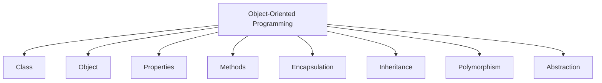

## Real-World Example: A Car

| Part | Example |
|---|---|
| Properties | brand, color, speed |
| Methods | start, stop, accelerate |

```typescript
class Car {
  constructor(
    public brand: string,
    public color: string
  ) {}

  start(): void {
    console.log(`${this.brand} has started`);
  }

  stop(): void {
    console.log(`${this.brand} has stopped`);
  }
}

const myCar = new Car("Toyota", "Black");
myCar.start();
```

## Interview Questions

**Q1. What is OOP?**  
OOP is a programming approach that organizes code around objects containing data and behavior.

**Q2. Why is OOP useful?**  
It can improve organization, reuse, and maintainability in applications.

**Q3. What are the four commonly taught pillars of OOP?**  
Encapsulation, inheritance, polymorphism, and abstraction.

## Practice Exercises

1. Think of three real-world objects.
2. Write at least three properties for each.
3. Write at least two methods for each.
4. Create a `Car` class with properties and methods.
5. Explain OOP in your own words.

## Quick Revision

- OOP means Object-Oriented Programming.
- Objects combine data and behavior.
- Classes are used to define objects.
- The four commonly taught pillars are encapsulation, inheritance, polymorphism, and abstraction.

---

# 3-2. Class and Object

*Beginner · Core OOP Building Blocks*

## Learning Objectives

- Explain what a class is.
- Explain what an object is.
- Create a class using TypeScript.
- Create multiple objects from one class.

## What Is a Class?

A class is a **blueprint or template** used to create objects. It describes which properties and methods objects created from that class can have.

## What Is an Object?

An object is an **instance of a class**. Each object can have its own property values while sharing the class's methods.

## Visual Explanation


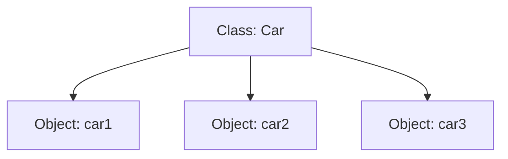

**Real-world analogy:**

- Class = house blueprint.
- Object = an actual house built from that blueprint.

One blueprint can be used to build many houses. In the same way, one class can create many objects.

## TypeScript Example

```typescript
class Car {
  constructor(
    public brand: string,
    public color: string
  ) {}

  drive(): string {
    return `${this.brand} car is driving`;
  }
}

const car1 = new Car("Toyota", "Black");
const car2 = new Car("Honda", "White");

console.log(car1.drive());
console.log(car2.drive());
```

## Understand the Code

- `class Car` defines a class.
- `constructor()` runs when a new object is created.
- `public brand` and `public color` are parameter properties. TypeScript creates and initializes those properties.
- `new Car(...)` creates an object.
- `car1` and `car2` are separate objects.
- `drive()` is a method.

## Interview Questions

**Q1. What is a class?**  
A class is a blueprint for creating objects.

**Q2. What is an object?**  
An object is an instance of a class.

**Q3. Can one class create multiple objects?**  
Yes. Each object can have its own property values.

## Practice Exercises

1. Create a `Student` class.
2. Add `name` and `roll` properties.
3. Add an `introduce()` method.
4. Create two student objects.
5. Print their details.

## Quick Revision

- Class = blueprint.
- Object = instance.
- A class can create many objects.
- Each object can store its own state.

---

# 3-3. Encapsulation

*Beginner · Protecting Data*

## Learning Objectives

- Understand encapsulation.
- Use `private` and `protected`.
- Control how class data is changed.
- Use getters and setters.

## What Is Encapsulation?

Encapsulation means keeping related data and methods together inside a class and controlling access to internal data.

**Simple idea:** Do not let outside code change important data in any way it wants. Provide methods that check whether a change is valid.

## Why Is It Useful?

Encapsulation can help protect important data, prevent invalid values, keep rules in one place, and make a class easier to use safely.

## Visual Explanation


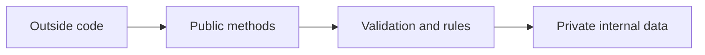

## Example: Bank Account

```typescript
class BankAccount {
  private balance: number = 0;

  deposit(amount: number): void {
    if (amount <= 0) {
      throw new Error("Deposit must be positive");
    }

    this.balance += amount;
  }

  getBalance(): number {
    return this.balance;
  }
}

const account = new BankAccount();

account.deposit(500);
console.log(account.getBalance()); // 500

// account.balance = 1000; // Error: balance is private
```

The `balance` property cannot be accessed directly from outside the class. The `deposit()` method controls how money is added.

## Getters and Setters

A getter reads a value. A setter controls how a value is updated.

```typescript
class Employee {
  constructor(
    public name: string,
    private _baseSalary: number
  ) {}

  get baseSalary(): number {
    return this._baseSalary;
  }

  set baseSalary(newSalary: number) {
    if (newSalary < 0) {
      throw new Error("Salary cannot be negative");
    }

    this._baseSalary = newSalary;
  }

  describe(): string {
    return `${this.name} earns ${this.baseSalary}`;
  }
}

const employee = new Employee("Mir", 22000);

console.log(employee.describe());

employee.baseSalary = 25000;
console.log(employee.baseSalary);
```

## Access Modifiers

| Modifier | Meaning |
|---|---|
| `public` | Accessible from outside the class and from subclasses |
| `protected` | Accessible inside the class and its subclasses |
| `private` | Accessible only inside the declaring class |

**Note:** TypeScript's `private` and `protected` modifiers are compile-time access restrictions. JavaScript's `#private` fields provide runtime-enforced private fields.

## Common Mistakes

- Making every property public even when it needs validation.
- Using a setter without validating the new value.
- Thinking `protected` means private.
- Confusing TypeScript's `private` modifier with JavaScript's `#private` fields.

## Interview Questions

**Q1. What is encapsulation?**  
It is the practice of keeping data and related behavior together while controlling access to internal state.

**Q2. Why use private properties?**  
To prevent direct access and make updates go through controlled methods.

**Q3. What is the difference between private and protected?**  
Private is accessible only inside the declaring class. Protected is also accessible in subclasses.

## Practice Exercises

1. Create a `BankAccount` class.
2. Make `balance` private.
3. Add `deposit()` and `withdraw()` methods.
4. Prevent negative deposits and withdrawals.
5. Add a getter to read the balance.
6. Create an `Employee` class with a salary setter.

## Quick Revision

- Encapsulation controls access to data.
- `private` restricts access to the declaring class.
- `protected` allows access in subclasses.
- Getters and setters can enforce rules.

---

# 3-4. Inheritance

*Beginner · Reusing and Extending Code*

## Learning Objectives

- Explain inheritance.
- Identify parent and child classes.
- Use `extends`.
- Use `super()` to call the parent constructor.

## What Is Inheritance?

Inheritance allows one class to reuse and extend the properties and methods of another class.

- **Parent class:** The class being extended.
- **Child class:** The class that extends the parent.

**Simple idea:** A child class gets useful features from a parent class and can add its own features.

## Visual Explanation


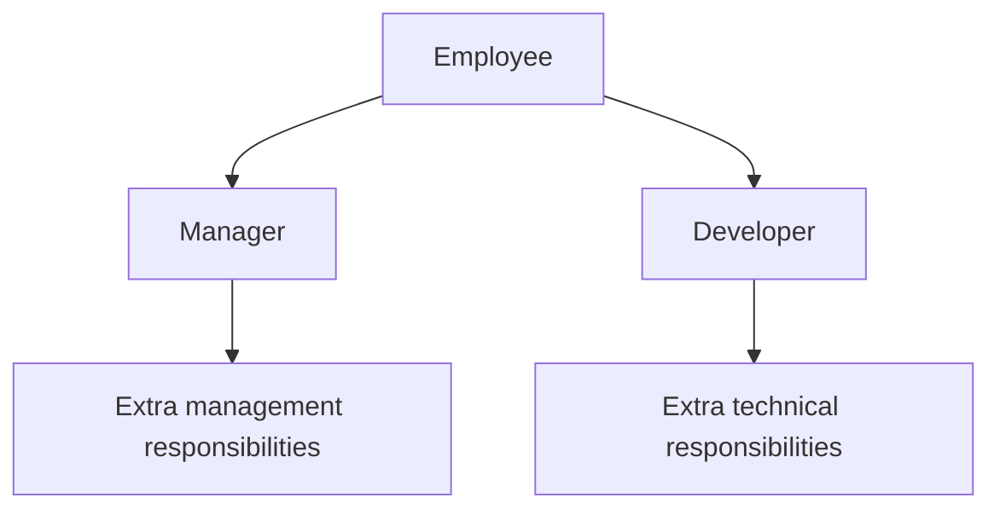

**Real-world analogy:** A Manager is an Employee with additional responsibilities. A Developer is also an Employee but has different responsibilities.

## TypeScript Example

```typescript
class Employee {
  constructor(
    public name: string,
    protected _baseSalary: number
  ) {}

  get baseSalary(): number {
    return this._baseSalary;
  }

  set baseSalary(newSalary: number) {
    if (newSalary < 0) {
      throw new Error("Salary cannot be negative");
    }

    this._baseSalary = newSalary;
  }

  describe(): string {
    return `${this.name} earns ${this.baseSalary}`;
  }
}

class Manager extends Employee {
  constructor(
    name: string,
    _baseSalary: number,
    public teamMemberCount: number
  ) {
    super(name, _baseSalary);
  }

  describeWork(): string {
    return `${this.name} manages ${this.teamMemberCount} people`;
  }

  describeManager(): string {
    return `${this.name} earns ${this._baseSalary}`;
  }
}

const employee = new Employee("Mir", 22000);
console.log(employee.describe());

const manager = new Manager("Mizan", 24000, 20);
console.log(manager.describeWork());
console.log(manager.describeManager());
```

## Understand the Code

- `Manager extends Employee`: Manager inherits from Employee.
- `super(name, _baseSalary)`: Calls the parent constructor.
- `teamMemberCount`: Adds a property specific to Manager.
- `describeWork()`: Adds a method specific to Manager.
- `_baseSalary` is protected, so the child class can access it.
- The getter and setter allow controlled reading and updating of salary.

## Common Mistakes

- Forgetting to call `super()` before using `this` in a derived constructor.
- Trying to access a parent's private property from a child class.
- Using inheritance without a meaningful "is-a" relationship.
- Forgetting that a child class can add its own properties and methods.

## Interview Questions

**Q1. What is inheritance?**  
It allows a child class to reuse and extend a parent class.

**Q2. What does `extends` do?**  
It establishes a class inheritance relationship.

**Q3. What does `super()` do?**  
It calls the parent class constructor.

## Practice Exercises

1. Create a `Person` class.
2. Create a `Teacher` class extending `Person`.
3. Add a `subject` property to `Teacher`.
4. Use `super()` to initialize the parent properties.
5. Add a method that is only available on `Teacher`.

## Quick Revision

- Inheritance reuses and extends class behavior.
- `extends` creates the relationship.
- `super()` calls the parent constructor.
- A child class can add its own features.

---

# 3-5. Inheritance Continued

*Intermediate · Constructors, Access, and Method Reuse*

## Learning Objectives

- Understand parent and child class relationships.
- Use inherited methods.
- Understand constructor parameter properties.
- Compare `public`, `protected`, and `private`.
- Recognize when inheritance is useful.

## How Does Inheritance Work?

A child class can use accessible properties and methods from its parent class. It can also add new properties and methods or override an inherited method.

## Visual Explanation


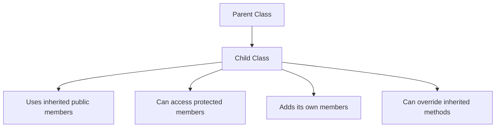

## Example: Animal and Dog

```typescript
class Animal {
  constructor(public name: string) {}

  eat(): string {
    return `${this.name} is eating`;
  }
}

class Dog extends Animal {
  bark(): string {
    return `${this.name} is barking`;
  }
}

const dog = new Dog("Tommy");

console.log(dog.eat());  // Inherited method
console.log(dog.bark()); // Child method
```

## Access Modifier Comparison

| Modifier | Same class | Child class | Outside class |
|---|---:|---:|---:|
| `public` | Yes | Yes | Yes |
| `protected` | Yes | Yes | No |
| `private` | Yes | No | No |

## When Should You Use Inheritance?

Use inheritance when there is a genuine **is-a** relationship.

Examples:

- Manager is an Employee.
- Dog is an Animal.
- Car is a Vehicle.

Do not use inheritance only to avoid repeating code. Sometimes composition is a better choice.

## Interview Questions

**Q1. What is an is-a relationship?**  
It means one class is a specific kind of another class.

**Q2. Can a child class add its own methods?**  
Yes.

**Q3. Can a child class access a protected property?**  
Yes, it can access the protected property through inheritance.

## Practice Exercises

1. Create an `Animal` class.
2. Create a `Bird` class extending `Animal`.
3. Add a `fly()` method.
4. Add a protected property to the parent.
5. Try accessing a private property from the child and inspect the error.

## Quick Revision

- Child classes inherit accessible parent members.
- Child classes can add new behavior.
- `protected` is available to subclasses.
- Use inheritance when the relationship makes sense.

---

# 3-6. Polymorphism

*Intermediate · One Interface, Many Forms*

## Learning Objectives

- Explain polymorphism.
- Understand method overriding.
- Use a parent type to refer to different child objects.
- Write flexible code with common methods.

## What Is Polymorphism?

Polymorphism means **many forms**.

In OOP, different objects can respond to the same method call in different ways.

For example, a Dog and a Cat can both have a `makeSound()` method, but each produces a different sound.

## Visual Explanation


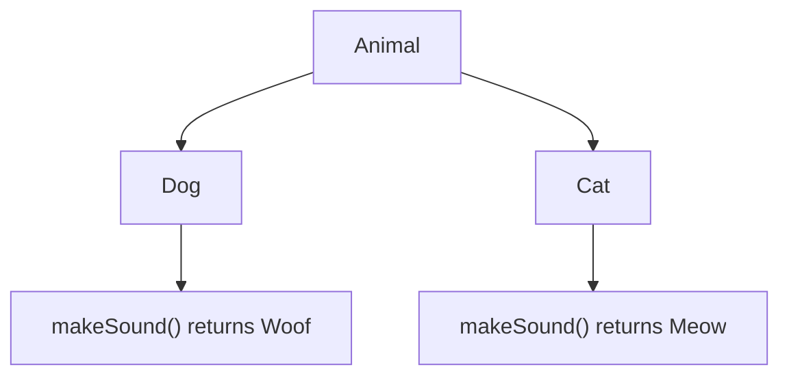

## TypeScript Example

```typescript
class Animal {
  makeSound(): string {
    return "Some generic sound";
  }
}

class Dog extends Animal {
  override makeSound(): string {
    return "Woof";
  }
}

class Cat extends Animal {
  override makeSound(): string {
    return "Meow";
  }
}

const animals: Animal[] = [
  new Dog(),
  new Cat(),
  new Animal()
];

animals.forEach((animal) => {
  console.log(animal.makeSound());
});
```

The `override` keyword makes it clear that the child class is intentionally replacing a method from the parent class. It also helps the compiler check that the parent method exists.

## What Happened Here?

- All objects share the `Animal` base type.
- Each child class provides its own `makeSound()` implementation.
- The same method call produces different results depending on the actual object.

## Why Is It Useful?

Polymorphism helps you write flexible code, work with different objects through a common type, add new implementations, and reduce large conditional blocks in suitable designs.

## Interview Questions

**Q1. What is polymorphism?**  
It allows different objects to respond to the same method or interface in different ways.

**Q2. What is method overriding?**  
A child class provides its own implementation of an inherited method.

**Q3. What does `override` do in TypeScript?**  
It marks an intentional override and helps the compiler verify it.

## Practice Exercises

1. Create a `Shape` base class.
2. Add a `getArea()` method.
3. Create `Circle` and `Rectangle` child classes.
4. Override `getArea()` in each class.
5. Store both objects in a `Shape[]` array and call `getArea()`.

## Quick Revision

- Polymorphism means many forms.
- Method overriding is a common OOP example.
- A common parent type can represent different child objects.
- The actual object's implementation is used at runtime.

---

# 3-7. Abstraction

*Intermediate · Hiding Complexity*

## Learning Objectives

- Explain abstraction.
- Understand abstract classes.
- Create abstract methods.
- Implement abstract methods in child classes.

## What Is Abstraction?

Abstraction means hiding unnecessary implementation details and exposing the important operations.

**Simple idea:** Focus on what an object should do, without requiring every user of the object to know how it does it.

## Real-world Analogy

When you use a TV remote, you press the power button. You do not need to understand the electronics inside the television.

The remote provides a simple interface while the internal implementation stays hidden.

## Visual Explanation


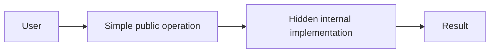

## Abstract Classes

An abstract class cannot be instantiated directly. It can define shared properties and methods, and it can require child classes to implement abstract methods.

```typescript
abstract class UIElement {
  constructor(protected id: string) {}

  abstract render(): string;
}
```

The `render()` method has no implementation in the abstract class. Child classes must provide one.

## Implementing an Abstract Class

```typescript
class Button extends UIElement {
  constructor(
    id: string,
    private label: string
  ) {
    super(id);
  }

  override render(): string {
    return `<button id="${this.id}">${this.label}</button>`;
  }
}

const button = new Button("submit", "Submit");

console.log(button.render());
```

## Why Is Abstraction Useful?

- It defines a common contract.
- It hides implementation details.
- It encourages consistent behavior.
- It separates what an object does from how it does it.

## Abstract Class vs Concrete Class

| Abstract Class | Concrete Class |
|---|---|
| Cannot be instantiated directly | Can be instantiated |
| Can contain abstract methods | Implements required behavior |
| Can contain implemented methods | Can contain implemented methods |
| Often used as a base class | Used to create objects |

## Interview Questions

**Q1. What is abstraction?**  
It hides internal complexity and exposes essential operations.

**Q2. What is an abstract class?**  
A class that cannot be instantiated directly and may contain abstract methods.

**Q3. Must a child class implement an inherited abstract method?**  
A concrete child class must implement all inherited abstract methods.

## Practice Exercises

1. Create an abstract `Vehicle` class.
2. Add an abstract `start()` method.
3. Create `Car` and `Bike` classes.
4. Implement `start()` in both classes.
5. Create objects and call the method.

## Quick Revision

- Abstraction hides implementation details.
- Abstract classes cannot be instantiated directly.
- Abstract methods define behavior that concrete child classes must implement.

---

# 3-8. Fun with OOP — MiniDOM Part 1

*Intermediate · Building UI Elements with OOP*

## Learning Objectives

- Apply abstraction and inheritance in a small project.
- Create a common UI element base class.
- Build Input and Button classes.
- Understand how each class provides its own `render()` method.

## Project Idea

We will build a small UI rendering system called **MiniDOM**.

The first part creates a base class and two UI components:

- `Input`
- `Button`

Both components return an HTML string from their `render()` method.

## Visual Explanation


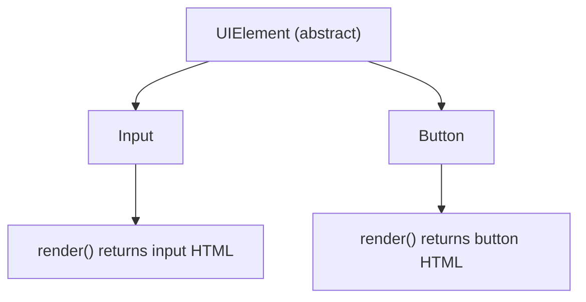

## Step 1 — Create the Abstract Base Class

```typescript
abstract class UIElement {
  constructor(protected id: string) {}

  abstract render(): string;
}
```

**Explanation:**

- `UIElement` is an abstract class.
- `id` is protected, so child classes can access it.
- `render()` is an abstract method.
- Every concrete child class must implement `render()`.

## Step 2 — Create the Input Class

```typescript
class Input extends UIElement {
  constructor(
    id: string,
    private type: string,
    private placeholder: string
  ) {
    super(id);
  }

  override render(): string {
    return `<input id="${this.id}" type="${this.type}" name="${this.id}" placeholder="${this.placeholder}"/>`;
  }
}
```

The Input class inherits the `id` property and implements its own HTML rendering logic.

## Step 3 — Create the Button Class

```typescript
class Button extends UIElement {
  constructor(
    id: string,
    private label: string
  ) {
    super(id);
  }

  override render(): string {
    return `<button id="${this.id}">${this.label}</button>`;
  }
}
```

The Button class also inherits from `UIElement`, but it produces button HTML instead of input HTML.

## What Did We Learn?

| OOP Concept | Where It Appears |
|---|---|
| Abstraction | `UIElement` |
| Inheritance | `Input extends UIElement` |
| Encapsulation | Private `type`, `placeholder`, and `label` |
| Polymorphism | Different `render()` implementations |

## Practice Exercises

1. Create a `Textarea` class extending `UIElement`.
2. Add a `placeholder` property.
3. Implement `render()`.
4. Create an object and print its HTML string.
5. Explain why `UIElement` is abstract.

## Quick Revision

- `UIElement` defines a common contract.
- `Input` and `Button` inherit from it.
- Each child implements its own `render()` method.
- The design uses abstraction, inheritance, and polymorphism.

---

# 3-9. Fun with OOP — MiniDOM Part 2

*Intermediate · Combining UI Elements with Composition*

## Learning Objectives

- Create a Form class.
- Store different UI elements in one collection.
- Understand composition.
- Render multiple child elements together.
- Connect rendered HTML to a DOM element.

## Project Idea

In Part 1, we created Input and Button components.

Now we will create a `Form` class that can contain multiple UI elements.

A form can contain:

- Name input.
- Email input.
- Password input.
- Submit button.

## Visual Explanation


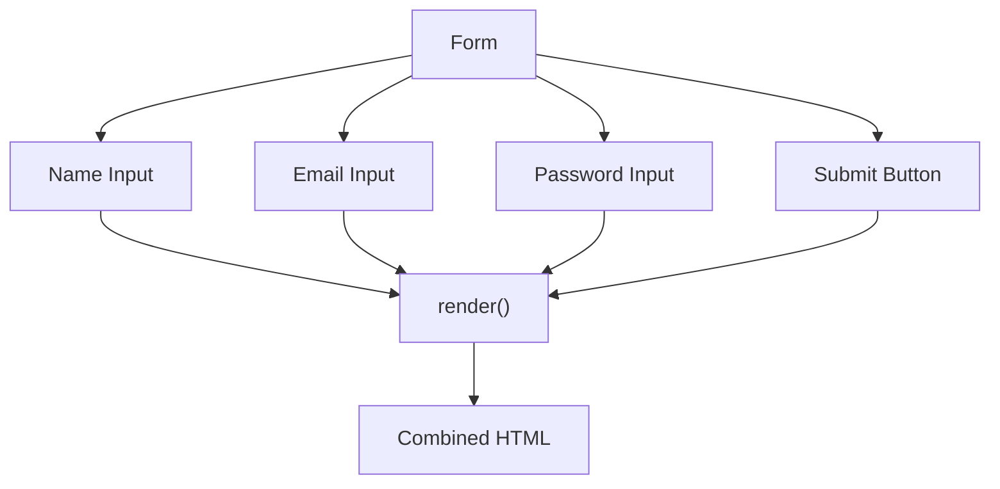

## Create the Form Class

The Form class stores its children in an array of `UIElement`.

```typescript
class Form extends UIElement {
  private children: UIElement[] = [];

  appendChild(child: UIElement): void {
    this.children.push(child);
  }

  override render(): string {
    const childrenHTML = this.children
      .map((child) => child.render())
      .join("\n");

    return `
      <form
        id="${this.id}"
        style="
          border: 1px solid #ccc;
          padding: 20px;
          display: flex;
          flex-direction: column;
          max-width: 300px;
          border-radius: 10px;
          gap: 5px;
        "
      >
        ${childrenHTML}
      </form>
    `;
  }
}
```

## Build the Form

The following code uses the `UIElement`, `Input`, and `Button` classes from Part 1.

```typescript
const formElement = new Form("login-form");

const nameInput = new Input(
  "name",
  "text",
  "Enter your name"
);

const emailInput = new Input(
  "email",
  "email",
  "Enter your email"
);

const passwordInput = new Input(
  "pass",
  "password",
  "Enter your password"
);

const submitButton = new Button(
  "submit-btn",
  "Submit"
);

formElement.appendChild(nameInput);
formElement.appendChild(emailInput);
formElement.appendChild(passwordInput);
formElement.appendChild(submitButton);

console.log(formElement.render());
```

## Add the Form to the Browser DOM

```typescript
const rootElement = document.getElementById("root");

if (rootElement) {
  rootElement.innerHTML = formElement.render();
}
```

The code looks for an element with the ID `root` and inserts the generated HTML into it.

Your HTML page needs an element such as:

```html
<div id="root"></div>
```

**Security note:** This learning example generates HTML from fixed values. Do not insert untrusted user input into `innerHTML`. In real applications, use safe DOM APIs such as `document.createElement()` and `textContent`, or use a framework with appropriate escaping.

## What Is Composition?

Composition means building a larger object by combining smaller objects.

Here:

- Form contains Input objects.
- Form contains a Button object.
- Form works with all of them through the common `UIElement` type.

This is a **has-a** relationship: a Form has UI elements.

## Composition vs Inheritance

| Inheritance | Composition |
|---|---|
| Represents an "is-a" relationship | Represents a "has-a" relationship |
| Reuses behavior from a parent | Combines smaller objects |
| Example: Manager is an Employee | Example: Form has Inputs and Buttons |

## What Did We Achieve?

We built a small UI rendering system using abstraction, inheritance, polymorphism, encapsulation, and composition.

This is a learning project, not a complete UI framework like React or Angular.

## Interview Questions

**Q1. Why is `children` an array of `UIElement[]`?**  
Because Form can store different UI elements that share the same base type.

**Q2. What design concept is shown when Form contains multiple UI elements?**  
Composition.

**Q3. What does `appendChild()` do?**  
It adds a child UI element to the Form's collection.

**Q4. Why can `child.render()` call different implementations?**  
Because each child object provides its own implementation of the shared `render()` method.

## Practice Exercises

1. Add another Button.
2. Create a `Textarea` class.
3. Create a `Select` class.
4. Append all components to the Form.
5. Render the final form.
6. Explain how composition is used.

## Quick Revision

- Form stores multiple UI elements.
- `UIElement[]` allows different child objects in one collection.
- Each child renders itself.
- Form combines the returned HTML.
- Composition means building a larger object from smaller objects.

---

# 3-10. Utility Classes

*Intermediate · Reusable Helper Methods*

## Learning Objectives

- Understand what a utility class is.
- Use static properties and methods.
- Call methods without creating an object.
- Recognize when a utility class is useful.

## What Is a Utility Class?

A utility class groups related helper methods in one place.

Utility methods are often `static`, which means you can call them directly using the class name without creating an object.

**Simple idea:** A utility class provides reusable tools for common tasks.

## Visual Explanation


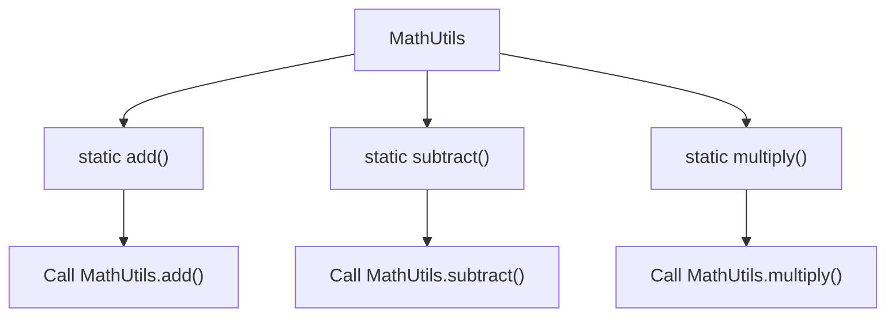

## Example: Math Utility Class

```typescript
class MathUtils {
  static add(a: number, b: number): number {
    return a + b;
  }

  static subtract(a: number, b: number): number {
    return a - b;
  }

  static multiply(a: number, b: number): number {
    return a * b;
  }
}

console.log(MathUtils.add(5, 3));       // 8
console.log(MathUtils.subtract(10, 2)); // 8
console.log(MathUtils.multiply(3, 4));  // 12
```

Notice that we do not need to write `new MathUtils()`.

## Example: String Utility Class

```typescript
class StringUtils {
  static capitalize(text: string): string {
    if (text.length === 0) {
      return text;
    }

    return text.charAt(0).toUpperCase() + text.slice(1);
  }

  static reverse(text: string): string {
    return text.split("").reverse().join("");
  }
}

console.log(StringUtils.capitalize("typescript"));
console.log(StringUtils.reverse("hello"));
```

## What Does `static` Mean?

A static member belongs to the class itself rather than to an individual object.

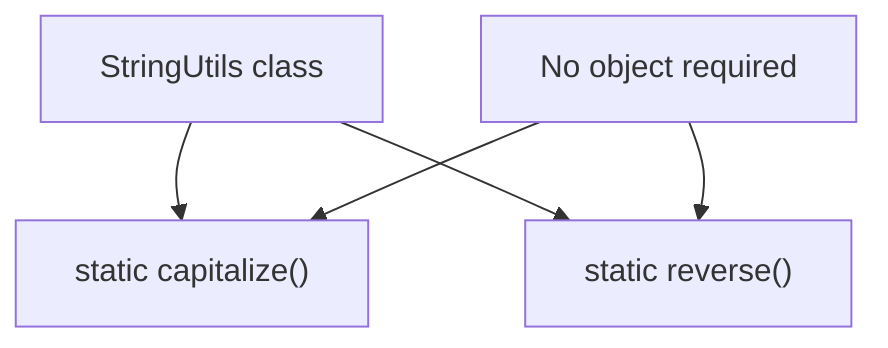

## When Should You Use Utility Classes?

Use them when several related helper methods belong together, the methods do not need individual object state, and a class-based grouping makes the code easier to discover.

**Design note:** In TypeScript, standalone exported functions can also be a good choice. Do not create a utility class just because every function could be placed inside a class.

## Interview Questions

**Q1. What is a utility class?**  
A class that groups reusable helper methods.

**Q2. What is a static method?**  
A method that belongs to the class itself and can be called without creating an instance.

**Q3. Why are utility methods often static?**  
They usually do not need per-object state.

## Practice Exercises

1. Create a `DateUtils` class.
2. Add a static method that formats a date.
3. Create an `ArrayUtils` class.
4. Add a static method that returns the first element of an array.
5. Call the methods without creating objects.

## Quick Revision

- Utility classes group helper methods.
- Static methods are called through the class name.
- Static methods do not need an instance.
- Standalone functions can sometimes be simpler.

---

# 3-11. Closing Words

*Beginner · Final Summary*

## What You Learned

In this module, you learned:

- What OOP is.
- How classes and objects work.
- How encapsulation protects internal data.
- How inheritance reuses and extends code.
- How polymorphism allows different behavior through a common method.
- How abstraction hides implementation details.
- How to build a small UI system using OOP.
- How utility classes provide reusable helper methods.

## Big Visual Summary


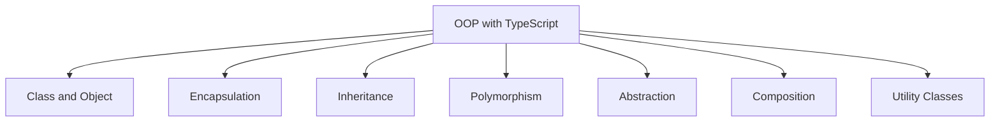

## Final Advice

Do not only read OOP. Build small examples and explain why you designed them in a particular way.

Good practice projects:

- Student management system.
- Bank account system.
- Library management system.
- Product and shopping cart system.
- Simple UI component system.

---

# Module Review

## Learning Progress Tracker

- [ ] 3-1. What Is OOP?
- [ ] 3-2. Class and Object
- [ ] 3-3. Encapsulation
- [ ] 3-4. Inheritance
- [ ] 3-5. Inheritance Continued
- [ ] 3-6. Polymorphism
- [ ] 3-7. Abstraction
- [ ] 3-8. Fun with OOP — MiniDOM Part 1
- [ ] 3-9. Fun with OOP — MiniDOM Part 2
- [ ] 3-10. Utility Classes
- [ ] 3-11. Closing Words

## Module Completion Criteria

This module is complete when you can:

1. Explain OOP in simple language.
2. Create classes and objects.
3. Use encapsulation with private and protected properties.
4. Use inheritance correctly.
5. Explain and implement polymorphism.
6. Use abstract classes and methods.
7. Build the MiniDOM learning project.
8. Explain composition and utility classes.
9. Answer basic OOP interview questions.

---

# Final Module Challenge

## Project: Employee Management System

Build a small TypeScript OOP project.

### Requirements

- Create an `Employee` class.
- Create a `Manager` class extending `Employee`.
- Use a getter and setter for salary.
- Validate that salary cannot be negative.
- Add a `describe()` method.
- Override a method in a child class.
- Use an abstract base class if it makes sense.
- Add a utility function or utility class to format employee information.

### Suggested Structure

```text
employee-management/
│
├── src/
│   ├── models/
│   │   ├── employee.ts
│   │   └── manager.ts
│   ├── utils/
│   │   └── employee-utils.ts
│   └── index.ts
│
├── package.json
└── tsconfig.json
```

### Project Workflow

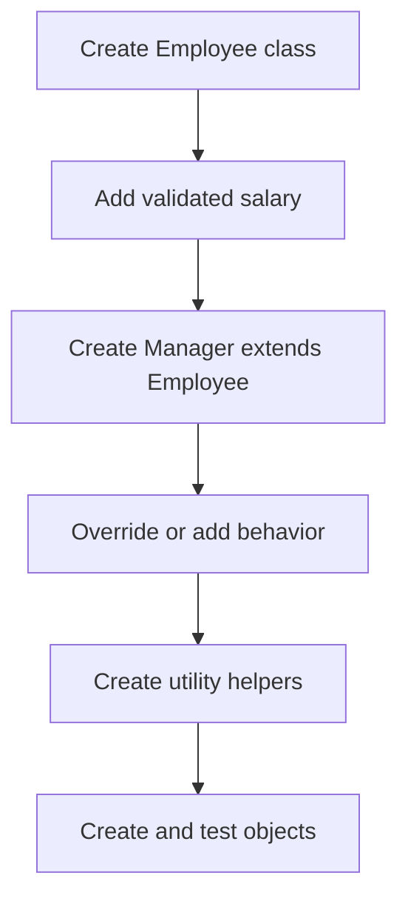

---

## Recommended Resources

1. [Official TypeScript Documentation](https://www.typescriptlang.org/docs/)
2. [TypeScript Classes Documentation](https://www.typescriptlang.org/docs/handbook/2/classes.html)
3. [TypeScript Playground](https://www.typescriptlang.org/play)
4. [TypeScript Handbook](https://www.typescriptlang.org/docs/handbook/intro.html)

---

## Next Module

**Module 04 — Advanced OOP and Design Principles**

Possible topics:

- Composition vs Inheritance.
- SOLID Principles.
- Design Patterns.
- Dependency Injection.
- Abstract Classes vs Interfaces.
- Practical Object-Oriented Design.

---

**Learn Deeply. Build Practically. Explain Clearly.**

*Part of the SDE Interview Prep Roadmap — An Open-Source Software Engineering Knowledge Base.*
