# Module 01 --- Node.js Fundamentals

**Learn Deeply. Build Practically. Explain Clearly.**

Welcome to Module 01 of the Node.js learning path. This module explains
how the web works, why Node.js exists, how its runtime works internally,
and how to use its core APIs confidently.

The goal is not to memorize Node.js methods. The goal is to understand
what happens behind the code you write, why a particular feature exists,
when to use it, and what trade-offs it introduces.

> **Learning approach:** Start with the mental model, study the visual,
> run the example, change the code, and then explain the concept in your
> own words.

------------------------------------------------------------------------

## Table of Contents

-   [Learning Objectives](#learning-objectives)
-   [Priority Guide](#priority-guide)
-   [Your Learning Workflow](#your-learning-workflow)
-   [Environment Setup](#environment-setup)
-   [1-1. How the Web Works from
    Scratch](#1-1-how-the-web-works-from-scratch)
-   [1-2. Frontend vs Backend
    Essentials](#1-2-frontend-vs-backend-essentials)
-   [1-3. Tracing Where Everything
    Began](#1-3-tracing-where-everything-began)
-   [1-4. How Node.js Changed Server-Side
    Development](#1-4-how-nodejs-changed-server-side-development)
-   [1-5. Node.js Architecture: The Big
    Picture](#1-5-nodejs-architecture-the-big-picture)
-   [1-6. V8 Engine and libuv](#1-6-v8-engine-and-libuv)
-   [1-7. Event-Driven Architecture and
    EventEmitter](#1-7-event-driven-architecture-and-eventemitter)
-   [1-8. Single-Threaded Node.js vs Multithreaded
    Servers](#1-8-single-threaded-nodejs-vs-multithreaded-servers)
-   [1-9. How the Event Loop Works](#1-9-how-the-event-loop-works)
-   [1-10. Asynchronous I/O, Callbacks, Promises, and
    Async/Await](#1-10-asynchronous-io-callbacks-promises-and-asyncawait)
-   [1-11. Streams, Buffers, and
    Backpressure](#1-11-streams-buffers-and-backpressure)
-   [1-12. Node.js Modules: IIFE, CommonJS, and
    ESM](#1-12-nodejs-modules-iife-commonjs-and-esm)
-   [1-13. Built-in Modules: fs, path, os, and
    HTTP](#1-13-built-in-modules-fs-path-os-and-http)
-   [1-14. Process, Environment Variables, and Runtime
    Configuration](#1-14-process-environment-variables-and-runtime-configuration)
-   [1-15. Error Handling in Node.js](#1-15-error-handling-in-nodejs)
-   [1-16. Worker Threads and Child
    Processes](#1-16-worker-threads-and-child-processes)
-   [1-17. Cluster, Profiling, and Memory
    Optimization](#1-17-cluster-profiling-and-memory-optimization)
-   [Common Mistakes](#common-mistakes)
-   [Module Review](#module-review)
-   [Interview Questions](#interview-questions)
-   [Practice Exercises](#practice-exercises)
-   [Quick Revision Sheet](#quick-revision-sheet)
-   [Recommended Resources](#recommended-resources)

------------------------------------------------------------------------

## Learning Objectives

By completing this module, you should be able to:

-   Explain what happens when a user enters a URL and opens a website.
-   Distinguish frontend, backend, server, runtime, and database.
-   Explain what Node.js is and why it was created.
-   Describe the roles of V8, libuv, Node.js core APIs, and the
    operating system.
-   Explain event-driven architecture and non-blocking I/O.
-   Understand what "single-threaded" means in Node.js---and what it
    does not mean.
-   Explain the Event Loop and its major phases at a useful practical
    level.
-   Choose between callbacks, Promises, and `async/await`.
-   Use CommonJS and ECMAScript Modules (ESM).
-   Understand the Node.js module wrapper and the relationship between
    `exports` and `module.exports`.
-   Work with built-in modules such as `fs`, `path`, `os`, `events`,
    `http`, `crypto`, and `stream`.
-   Understand Buffers, Streams, and backpressure.
-   Use process information and environment variables safely.
-   Handle synchronous errors, Promise rejections, callback errors, and
    EventEmitter errors.
-   Know when to use Worker Threads, child processes, and cluster.
-   Recognize common performance and memory problems and know how to
    investigate them.

------------------------------------------------------------------------

## Priority Guide

Use this priority system to decide how deeply to study each topic.

  -----------------------------------------------------------------------
  Priority                Meaning                 Topics
  ----------------------- ----------------------- -----------------------
  **P0 --- Core**         Understand deeply.      Architecture, V8,
                          These concepts appear   libuv, Event Loop,
                          regularly in real       asynchronous I/O,
                          backend work and        callbacks, Promises,
                          interviews.             async/await, modules,
                                                  EventEmitter, File
                                                  System, HTTP

  **P1 --- Important**    Understand well and     Streams, Buffers,
                          practise with small     process, environment
                          projects.               variables, error
                                                  handling, Worker
                                                  Threads, child
                                                  processes

  **P2 --- Advanced**     Understand the use      Cluster, profiling,
                          cases and trade-offs.   memory optimization
                          Practise when building  
                          systems that need them. 
  -----------------------------------------------------------------------

**Important:** Priority does not mean that P1 or P2 topics are
unimportant. It means you should first build a strong foundation in P0
topics.

------------------------------------------------------------------------

## Your Learning Workflow

For every topic, follow this sequence:

1.  **What:** Define the concept in simple words.
2.  **Why:** Understand the problem it solves.
3.  **How:** Understand its internal working.
4.  **When:** Identify when it is useful.
5.  **Example:** Run and modify the code.
6.  **Real-world use:** Connect it to an API, backend service, or
    production system.
7.  **Interview check:** Explain it without looking at the notes.

Do not move forward just because you have read the section. Move forward
when you can explain the main idea and write a small example yourself.

------------------------------------------------------------------------

## Environment Setup

### What do you need?

  Tool                        Purpose
  --------------------------- -------------------------------------------
  Node.js                     Runs JavaScript outside the browser
  npm                         Installs and manages JavaScript packages
  VS Code or another editor   Writes and edits code
  Terminal                    Runs Node.js commands
  Browser                     Tests HTTP endpoints and web applications

Install a supported **Active LTS** version of Node.js from the official
website. Avoid choosing an old version just because a tutorial uses it.

-   Official website: <https://nodejs.org/>
-   Check Node.js version: `node --version`
-   Check npm version: `npm --version`

### Create your first project

``` bash
mkdir node-fundamentals
cd node-fundamentals
npm init -y
```

For the examples in this module, use ECMAScript Modules (ESM). Add this
field to the generated `package.json`:

``` json
{
  "type": "module"
}
```

Create `index.js`:

``` js
console.log("Hello from Node.js!");
```

Run it:

``` bash
node index.js
```

Expected output:

``` text
Hello from Node.js!
```

**Why use `"type": "module"`?**

It tells Node.js to interpret `.js` files in this package as ES modules.
You can then use `import` and `export`. You can also use `.mjs` for ESM
or `.cjs` for CommonJS when you need to make the module type explicit.

------------------------------------------------------------------------

# 1-1. How the Web Works from Scratch

**Level:** Beginner\
**Priority:** P0

## 1. Learning Objectives

By the end of this lesson, you should be able to:

-   Explain the journey from a browser URL to a server response.
-   Define DNS, IP address, client, server, HTTP, and HTTPS.
-   Describe the basic request-response cycle.
-   Explain why a backend server is needed.

## 2. What happens when you open a website?

Imagine you type:

``` text
https://example.com/products
```

Your browser needs to find the server that hosts the website, connect to
it, request the page or data, and display the response.

A simplified journey looks like this:

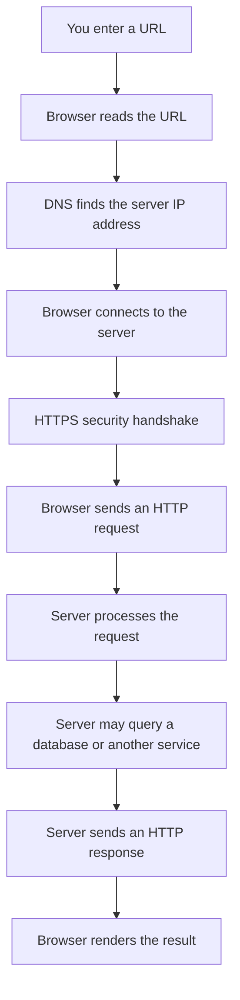

This is a simplified model. Modern browsers and servers can reuse
connections, use caches, and make multiple requests in parallel.

## 3. Important Terms

  -----------------------------------------------------------------------
  Term                                Simple meaning
  ----------------------------------- -----------------------------------
  Client                              A program that requests a service.
                                      A browser is a common client.

  Server                              A program or machine that receives
                                      requests and provides responses.

  IP address                          A network address used to identify
                                      a device or server.

  Domain name                         A human-friendly name such as
                                      `example.com`.

  DNS                                 The system that helps find the IP
                                      address associated with a domain
                                      name.

  HTTP                                A protocol used to exchange
                                      requests and responses on the web.

  HTTPS                               HTTP protected by TLS encryption
                                      and authentication.

  Request                             A message sent by a client to a
                                      server.

  Response                            A message returned by the server.

  Port                                A number that identifies a network
                                      service on a machine, such as
                                      `3000` or `443`.
  -----------------------------------------------------------------------

## 4. Understand the Request-Response Cycle

A browser might send a request similar to this:

``` http
GET /products HTTP/1.1
Host: example.com
Accept: application/json
```

The server may return:

``` http
HTTP/1.1 200 OK
Content-Type: application/json

{
  "products": [
    { "id": 1, "name": "Keyboard" },
    { "id": 2, "name": "Mouse" }
  ]
}
```

The request tells the server what the client wants. The response
contains a status code, headers, and usually a body.

### Common HTTP methods

  Method     Common purpose
  ---------- ----------------------------------
  `GET`      Read or retrieve data
  `POST`     Submit data or create a resource
  `PUT`      Replace a resource
  `PATCH`    Partially update a resource
  `DELETE`   Delete a resource

### Common HTTP status codes

  Status   Meaning
  -------- -------------------------------------------------
  `200`    Request succeeded
  `201`    Resource created
  `204`    Request succeeded with no response body
  `400`    Bad request
  `401`    Authentication is required or invalid
  `403`    The client is not allowed to perform the action
  `404`    Resource not found
  `500`    Unexpected server error

## 5. What is DNS?

People remember names more easily than numbers. DNS helps translate a
domain name into the information needed to reach the correct server.

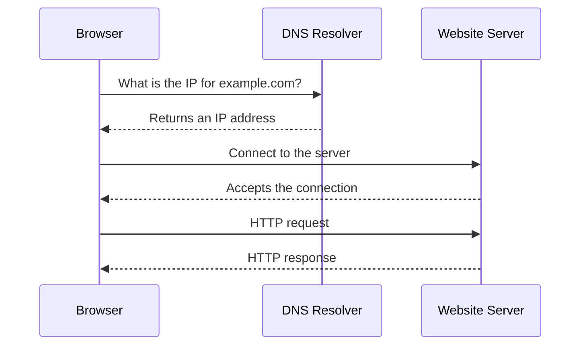

DNS answers can be cached. Therefore, the browser does not necessarily
perform a fresh DNS lookup for every request.

## 6. What is the difference between HTTP and HTTPS?

-   HTTP defines how web requests and responses are structured.
-   HTTPS is HTTP carried over a connection protected by TLS.
-   TLS helps provide encryption, integrity, and server authentication.

In simple words, HTTPS helps protect information while it travels
between the client and server.

## 7. Why does this matter for Node.js?

Node.js can create the server-side program that listens for HTTP
requests and sends responses.

For example, a Node.js server can:

1.  Receive a request from a browser.
2.  Read the URL and HTTP method.
3.  Validate the request.
4.  Query a database.
5.  Prepare a response.
6.  Send JSON or HTML back to the client.

## 8. Interview Questions

**Q1. What happens when you enter a URL in a browser?**

The browser parses the URL, resolves the domain through DNS when
necessary, establishes a network connection, performs TLS negotiation
for HTTPS, sends an HTTP request, receives a response, and renders the
result.

**Q2. What is the difference between a client and a server?**

A client requests a service. A server receives the request and provides
a response.

**Q3. What is DNS?**

DNS is a distributed naming system that helps resolve domain names to IP
addresses and related records.

## 9. Practice

1.  Open a website and identify its domain name.
2.  Open browser Developer Tools and select the Network tab.
3.  Reload the page and inspect one request.
4.  Identify its method, URL, status code, response headers, and
    response body.
5.  Explain the request-response cycle without looking at this section.

### Quick Revision

-   Browser = common client.
-   Node.js application = can act as a server.
-   DNS helps resolve domain names.
-   HTTP defines request-response communication.
-   HTTPS adds TLS protection.
-   A server may communicate with databases and other services before
    responding.

------------------------------------------------------------------------

# 1-2. Frontend vs Backend Essentials

**Level:** Beginner\
**Priority:** P0

## 1. What is Frontend?

The frontend is the part of an application that users interact with.

Examples:

-   Buttons
-   Forms
-   Navigation menus
-   Product cards
-   Dashboards
-   Login pages

Common frontend technologies include HTML, CSS, JavaScript, React, and
other UI frameworks.

## 2. What is Backend?

The backend handles application logic and server-side responsibilities.

Examples:

-   Authentication and authorization
-   Business rules
-   Database operations
-   Payment processing
-   File uploads
-   Sending emails
-   API endpoints

Node.js is commonly used to build backend applications and APIs.

## 3. Frontend vs Backend

  -----------------------------------------------------------------------
  Frontend                            Backend
  ----------------------------------- -----------------------------------
  Runs mainly in the user's browser   Runs on a server or server-like
                                      environment

  Focuses on user interface and       Focuses on application logic and
  interaction                         data

  Displays information                Retrieves, validates, processes,
                                      and stores information

  Uses HTML, CSS, JavaScript, React,  Uses Node.js, Express, NestJS,
  etc.                                databases, etc.

  Calls APIs                          Exposes APIs and consumes other
                                      services
  -----------------------------------------------------------------------

## 4. Visual: How Frontend and Backend Communicate

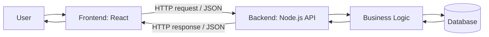

## 5. Practical Example: Login

Imagine a user enters an email and password.

1.  The frontend collects the values.
2.  The frontend sends them to a backend login endpoint.
3.  The backend validates the input.
4.  The backend finds the user record.
5.  The backend verifies the password using a suitable password-hashing
    library.
6.  The backend creates or returns an authentication result.
7.  The frontend updates the interface.

**Important:** The frontend should not be trusted to enforce security.
The backend must verify permissions and validate sensitive operations.

## 6. Why use Node.js for the Backend?

Node.js is useful when an application needs to handle many concurrent
network connections and I/O operations.

Examples include:

-   REST APIs
-   GraphQL APIs
-   Real-time chat
-   Notification services
-   WebSocket applications
-   Streaming services
-   Backend-for-frontend services

Node.js is not automatically the best tool for every workload. CPU-heavy
tasks may need Worker Threads, separate services, or another runtime
better suited to the task.

## 7. Interview Questions

**Q1. Can frontend code directly access a production database?**

It should not connect directly to a private production database. A
backend service should control access, validate requests, enforce
permissions, and protect credentials.

**Q2. What is an API?**

An API is a defined way for software components to communicate. A web
API commonly exposes endpoints that clients can call over HTTP.

**Q3. Can Node.js be used for frontend development?**

Node.js is not the browser UI itself. It is often used for development
tools, build systems, server-side rendering, and backend services.

### Quick Revision

-   Frontend = user interface and interaction.
-   Backend = business logic, security, and data operations.
-   API = communication contract between software components.
-   Node.js can power the backend.

------------------------------------------------------------------------

# 1-3. Tracing Where Everything Began

**Level:** Beginner\
**Priority:** P0

## 1. A Short History

To understand Node.js, first understand JavaScript.

-   **1995:** JavaScript was created by Brendan Eich while working at
    Netscape.
-   **Browser era:** JavaScript became widely used to make web pages
    interactive.
-   **2008:** Google introduced the V8 JavaScript engine with Chrome.
-   **2009:** Ryan Dahl introduced Node.js, using the V8 engine to run
    JavaScript outside the browser.
-   **2010:** npm became an important part of the Node.js ecosystem,
    making it easier to share and install packages.
-   **Today:** Node.js is used for APIs, backend services, tooling,
    automation, real-time systems, and more.

This is a simplified timeline, not a complete history of JavaScript or
Node.js.

## 2. Why was JavaScript originally associated with browsers?

A browser needs a way to respond to user actions without asking the
server to reload the entire page every time.

JavaScript made it possible to:

-   Respond to clicks.
-   Validate forms.
-   Change page content.
-   Make network requests.
-   Update the user interface dynamically.

But JavaScript was not limited by nature to the browser. The language
can run wherever an implementation provides a JavaScript engine and the
required runtime APIs.

## 3. What is a JavaScript Engine?

A JavaScript engine is software that parses and executes JavaScript.

Examples:

-   V8 --- used by Node.js and Chromium-based browsers.
-   SpiderMonkey --- used by Firefox.
-   JavaScriptCore --- used by Safari.

The engine executes the JavaScript language. It does not automatically
provide every API that a browser or server needs.

## 4. JavaScript Engine vs Runtime

This distinction is important.

  -----------------------------------------------------------------------
  JavaScript Engine                   JavaScript Runtime
  ----------------------------------- -----------------------------------
  Executes JavaScript                 Provides an environment in which
                                      JavaScript runs

  Handles parsing, compilation, and   Combines an engine with APIs and
  execution                           runtime facilities

  Example: V8                         Example: Node.js
  -----------------------------------------------------------------------

A browser runtime provides APIs such as the DOM, `fetch`, and browser
events.

Node.js provides APIs such as `fs`, `http`, `path`, `process`, and
`stream`.

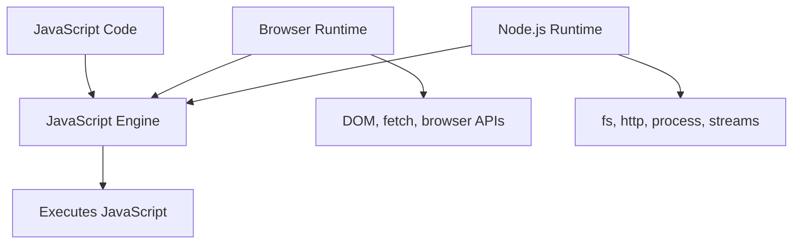

## 5. What problem did Node.js address?

JavaScript developers could already build interactive browser
experiences. Node.js made it practical to use JavaScript on the server
as well.

This allowed teams to use JavaScript across more parts of an
application, while Node.js provided an event-driven approach to network
programming.

## 6. Interview Questions

**Q1. Who created Node.js?**

Ryan Dahl introduced Node.js in 2009.

**Q2. What is V8?**

V8 is Google's open-source JavaScript and WebAssembly engine. Node.js
uses V8 to execute JavaScript.

**Q3. Is JavaScript the same thing as Node.js?**

No. JavaScript is a programming language. Node.js is a runtime
environment that executes JavaScript and provides server-side APIs.

### Quick Revision

-   JavaScript is a language.
-   V8 is a JavaScript engine.
-   Node.js is a runtime environment.
-   Node.js allows JavaScript to run outside the browser.

------------------------------------------------------------------------

# 1-4. How Node.js Changed Server-Side Development

**Level:** Beginner to Intermediate\
**Priority:** P0

## 1. The Traditional Thread-per-Request Idea

One traditional server design creates or assigns a separate thread to
handle each client request.

Imagine 1,000 clients connecting to a server. A thread-per-request
design may need many threads to handle those connections.

Threads have costs:

-   Memory for thread stacks and related resources.
-   CPU time spent switching between threads.
-   Synchronization complexity when threads share data.
-   More opportunities for race conditions.

This does not mean every traditional server uses exactly one thread per
request. Real server architectures vary and often use thread pools,
asynchronous I/O, event loops, or hybrid models.

## 2. Node.js's Approach

Node.js commonly uses one main JavaScript thread to execute application
JavaScript and an Event Loop to coordinate asynchronous operations.

Instead of waiting for every I/O operation to finish, the application
starts an operation and continues running other JavaScript. When the
operation completes, its callback or Promise continuation can run.

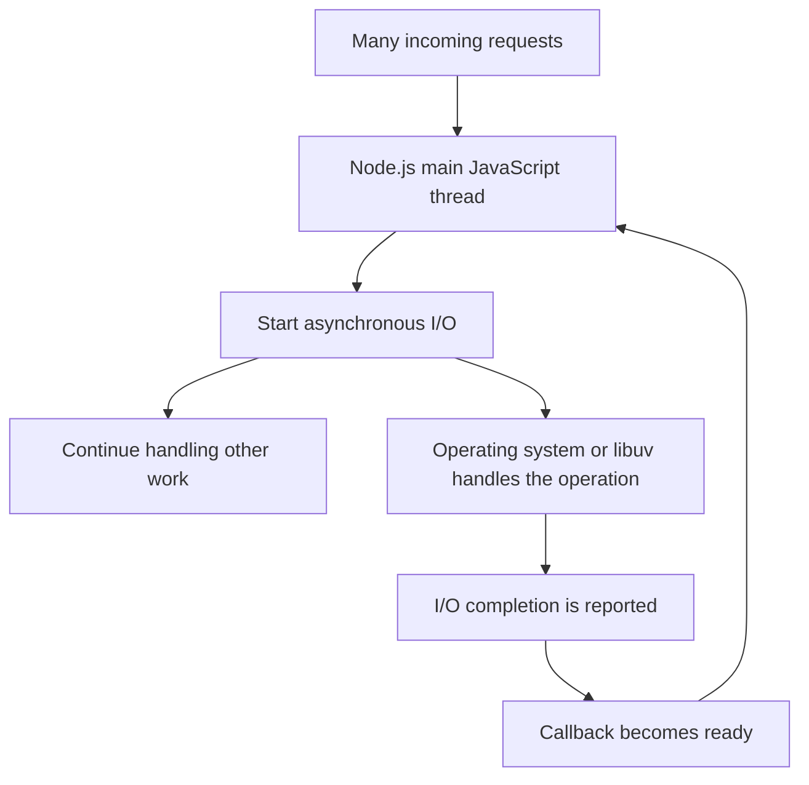

## 3. Why was this useful?

Many backend applications spend a large amount of time waiting for:

-   Database responses.
-   Network responses.
-   File operations.
-   External APIs.
-   Message queues.

While those operations are waiting, the JavaScript thread can work on
other ready tasks.

This makes Node.js a strong option for I/O-heavy services.

## 4. What Node.js did not magically solve

Node.js does not make CPU-heavy JavaScript automatically parallel.

For example:

``` js
function calculate() {
  let total = 0;

  for (let i = 0; i < 5_000_000_000; i++) {
    total += i;
  }

  return total;
}

console.log(calculate());
```

This loop runs synchronously on the main JavaScript thread. While it
runs, the Event Loop cannot execute other JavaScript callbacks on that
thread.

For CPU-heavy work, consider:

-   Worker Threads.
-   Separate child processes.
-   A job queue and dedicated workers.
-   A separate service written for the workload.

## 5. When is Node.js a good choice?

  -----------------------------------------------------------------------
  Workload                            Node.js fit
  ----------------------------------- -----------------------------------
  REST or GraphQL APIs                Very good

  Real-time chat and notifications    Very good

  I/O-heavy microservices             Very good

  WebSocket applications              Very good

  API gateway or backend-for-frontend Very good

  CPU-heavy image processing          Needs workers or another processing
                                      service

  Large scientific computation        Usually needs a specialized
                                      approach
  -----------------------------------------------------------------------

## 6. Interview Questions

**Q1. Why is Node.js suitable for I/O-heavy applications?**

It uses non-blocking I/O and an Event Loop, so the main JavaScript
thread does not need to wait synchronously for many I/O operations.

**Q2. Is Node.js always faster than a multithreaded server?**

No. Performance depends on the workload, architecture, implementation,
hardware, and bottlenecks.

**Q3. What is Node.js's main limitation?**

Long-running synchronous JavaScript can block the main Event Loop and
delay other work.

### Quick Revision

-   Node.js is event-driven and uses non-blocking I/O.
-   It avoids creating one JavaScript thread for every request.
-   It is particularly useful for I/O-heavy applications.
-   CPU-heavy JavaScript can block the Event Loop.

------------------------------------------------------------------------

# 1-5. Node.js Architecture: The Big Picture

**Level:** Intermediate\
**Priority:** P0

## 1. What is Node.js Architecture?

Node.js architecture describes how JavaScript code, the V8 engine,
Node.js core APIs, libuv, and the operating system work together.

You do not need to memorize every C++ implementation detail. You should
understand which part is responsible for which job.

## 2. Main Components

  -----------------------------------------------------------------------
  Component                           Simple responsibility
  ----------------------------------- -----------------------------------
  Your JavaScript code                Defines application behavior

  Node.js APIs                        Provide server-side features such
                                      as `fs`, `http`, and `crypto`

  V8                                  Executes JavaScript

  Node.js C/C++ bindings              Connect JavaScript APIs to
                                      lower-level implementation

  libuv                               Provides the Event Loop and
                                      cross-platform asynchronous I/O
                                      support

  Operating system                    Provides networking, file-system,
                                      and process facilities
  -----------------------------------------------------------------------

## 3. Visual Architecture

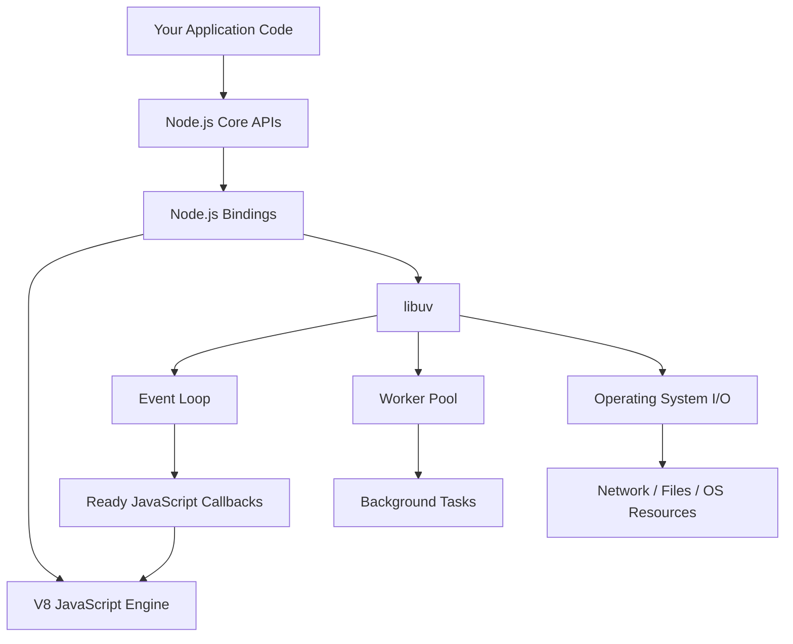

This diagram is conceptual. V8 executes JavaScript, while Node.js core
and libuv cooperate to expose runtime capabilities. Not every API
follows exactly the same internal path.

## 4. Example: Reading a File

``` js
import { readFile } from "node:fs/promises";

console.log("1. Start");

const content = await readFile("./notes.txt", "utf8");

console.log("2. File content:", content);
console.log("3. Finished");
```

At a high level:

1.  Your code calls `readFile`.
2.  Node.js starts an asynchronous file operation.
3.  The operation is handled using the runtime's file-system facilities
    and libuv's worker pool.
4.  The operation completes.
5.  The Promise is fulfilled.
6.  The `await` continuation runs and prints the file content.

The exact internal steps are more detailed, but this is a useful mental
model.

## 5. Why should a backend developer understand this?

Understanding the architecture helps explain:

-   Why synchronous file operations can block the Event Loop.
-   Why asynchronous I/O improves concurrency.
-   Why CPU-heavy work can slow down API responses.
-   Why Worker Threads can help with CPU-heavy JavaScript.
-   Why a slow database or external API can increase request latency.

## 6. Interview Questions

**Q1. What are the major components of Node.js architecture?**

V8, Node.js core APIs and bindings, libuv, the Event Loop, the worker
pool, and operating-system facilities.

**Q2. What is the role of Node.js bindings?**

They connect JavaScript-facing Node.js APIs with lower-level native
implementation.

**Q3. Does V8 handle file-system operations?**

No. V8 executes JavaScript. Node.js APIs and native components provide
file-system functionality.

### Quick Revision

-   V8 executes JavaScript.
-   Node.js provides server-side APIs.
-   libuv provides the Event Loop and asynchronous I/O support.
-   The OS provides networking and file-system facilities.
-   The worker pool handles certain operations outside the main
    JavaScript thread.

------------------------------------------------------------------------

# 1-6. V8 Engine and libuv

**Level:** Intermediate\
**Priority:** P0

## 1. What is V8?

V8 is an open-source JavaScript and WebAssembly engine developed by
Google.

Its main job is to execute JavaScript.

At a simplified level, V8:

1.  Reads JavaScript source code.
2.  Parses the source.
3.  Creates internal representations.
4.  Executes code using its interpreter and compiler infrastructure.
5.  Optimizes frequently executed code when possible.
6.  Manages JavaScript memory and garbage collection.

Modern V8 internals are more complex than this simplified pipeline.

## 2. Simple V8 Diagram

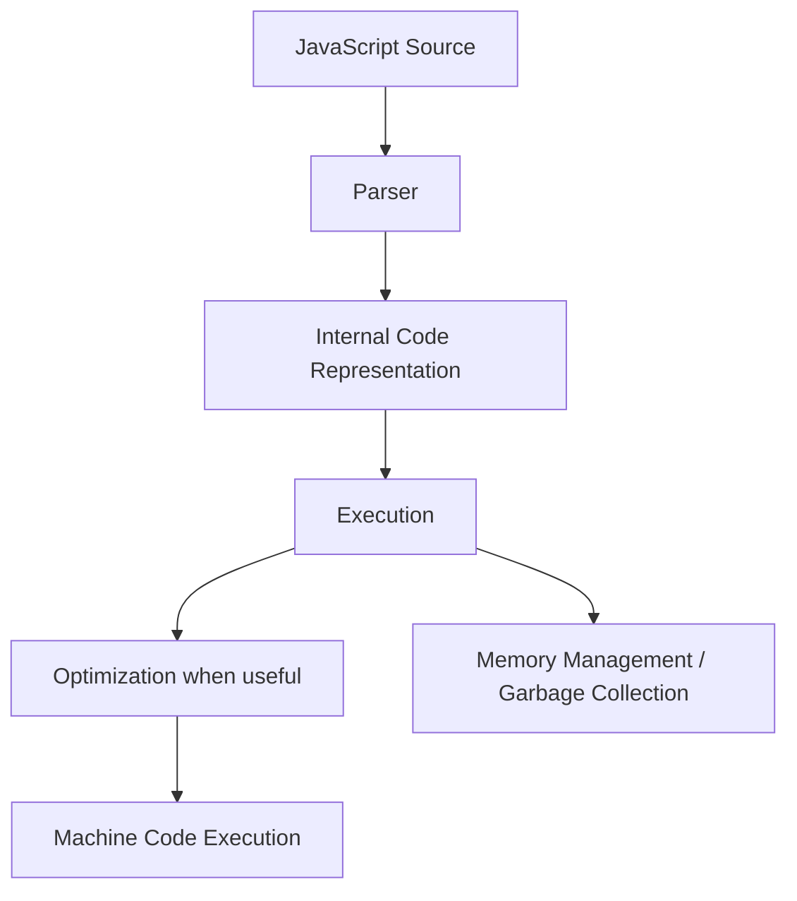

**Analogy:** V8 is like the engine of a car. It executes the JavaScript
instructions, but it does not provide every feature the complete vehicle
needs.

## 3. What is libuv?

libuv is a cross-platform library used by Node.js to support
asynchronous I/O and the Event Loop.

It helps Node.js work with operating-system facilities and provides a
worker pool for certain operations.

Examples of work that may use libuv's worker pool include:

-   Many file-system operations.
-   `dns.lookup()`.
-   Certain cryptographic operations.
-   Compression operations provided by zlib.

Network I/O often uses operating-system mechanisms directly rather than
sending every network operation to the libuv worker pool.

## 4. V8 vs libuv

  -----------------------------------------------------------------------
  V8                                  libuv
  ----------------------------------- -----------------------------------
  Executes JavaScript                 Coordinates asynchronous I/O and
                                      Event Loop work

  Manages JavaScript execution and    Provides a worker pool for selected
  heap                                operations

  Handles JavaScript garbage          Provides cross-platform I/O support
  collection                          

  Does not provide Node's `fs` API by Helps power Node's asynchronous
  itself                              runtime behavior
  -----------------------------------------------------------------------

## 5. Example: JavaScript Execution vs I/O

``` js
import { readFile } from "node:fs/promises";

console.log("A");

const filePromise = readFile("./notes.txt", "utf8");

console.log("B");

const content = await filePromise;

console.log("C:", content);
```

The file read is started before the program waits for the result. The
JavaScript thread can execute `console.log("B")` while the asynchronous
file operation is in progress.

## 6. When do these concepts matter?

-   When investigating a slow API.
-   When diagnosing Event Loop blocking.
-   When understanding why file-system operations can be asynchronous.
-   When choosing Worker Threads for CPU-heavy JavaScript.
-   When explaining how Node.js handles many concurrent connections.

## 7. Interview Questions

**Q1. What is V8?**

V8 is the JavaScript engine used by Node.js to execute JavaScript.

**Q2. What is libuv?**

libuv is a cross-platform library that provides the Event Loop,
asynchronous I/O support, and a worker pool used by Node.js.

**Q3. Does every asynchronous operation use the worker pool?**

No. Some operations use operating-system asynchronous I/O facilities,
while selected operations use the libuv worker pool.

### Quick Revision

-   V8 = JavaScript execution.
-   libuv = Event Loop and asynchronous I/O support.
-   The worker pool is used by selected APIs, not every asynchronous
    operation.

------------------------------------------------------------------------

# 1-7. Event-Driven Architecture and EventEmitter

**Level:** Intermediate\
**Priority:** P0

## 1. What is Event-Driven Architecture?

Event-driven architecture is a design approach in which one part of a
system produces an event and another part reacts to it.

An event represents something that has happened.

Examples:

-   A user registered.
-   An order was placed.
-   A payment succeeded.
-   A file finished uploading.
-   A socket connection was closed.

The component that produces an event does not always need to know every
component that will react to it.

## 2. Simple Analogy

Imagine a doorbell:

1.  Someone presses the bell.
2.  The bell produces a signal.
3.  People who are listening react to that signal.

The bell does not need to know exactly who will open the door.

## 3. Visual Flow

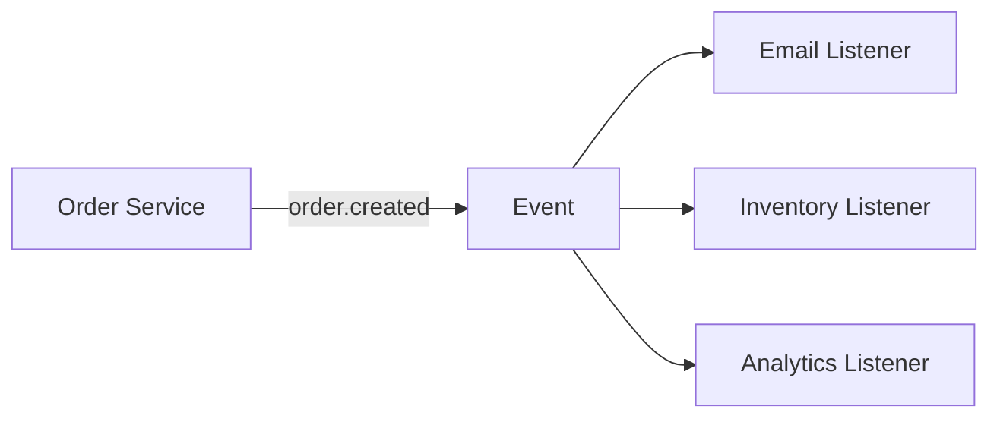

This is a conceptual event-driven system. In a small Node.js
application, events may be handled inside one process. In a distributed
system, a message broker may carry events between services.

## 4. What is EventEmitter?

`EventEmitter` is a Node.js class that lets objects emit named events
and lets functions listen for those events.

Important methods:

  Method                   Purpose
  ------------------------ ---------------------------------------------
  `on()`                   Register a listener
  `once()`                 Register a listener that runs at most once
  `emit()`                 Emit an event
  `off()`                  Remove a listener
  `removeListener()`       Remove a specific listener
  `removeAllListeners()`   Remove listeners for an event or all events

## 5. Practical Example

``` js
import { EventEmitter } from "node:events";

const orderEvents = new EventEmitter();

// Listener 1
orderEvents.on("order.created", (order) => {
  console.log(`Send confirmation for order ${order.id}`);
});

// Listener 2
orderEvents.on("order.created", (order) => {
  console.log(`Update inventory for product ${order.productId}`);
});

// Emit the event
orderEvents.emit("order.created", {
  id: 101,
  productId: 55
});
```

Output:

``` text
Send confirmation for order 101
Update inventory for product 55
```

## 6. Important: EventEmitter listeners are synchronous by default

This is a common interview point.

When you call `emit()`, registered listeners are called synchronously in
the order they were registered. EventEmitter itself does not
automatically move listeners to a background thread.

``` js
import { EventEmitter } from "node:events";

const emitter = new EventEmitter();

emitter.on("hello", () => {
  console.log("Listener");
});

console.log("Before");
emitter.emit("hello");
console.log("After");
```

Output:

``` text
Before
Listener
After
```

## 7. The Special `error` Event

An EventEmitter that emits an `'error'` event without a registered error
listener can cause the error to be thrown and the process to exit.

``` js
import { EventEmitter } from "node:events";

const emitter = new EventEmitter();

emitter.on("error", (error) => {
  console.error("Handled error:", error.message);
});

emitter.emit("error", new Error("Something went wrong"));
```

## 8. When should you use EventEmitter?

Use it when multiple parts of one Node.js process need to react to an
event without tightly coupling every part to every other part.

Examples:

-   Internal application events.
-   Custom streams.
-   Connection lifecycle events.
-   Background task status events.
-   Notifications inside a process.

Do not assume an in-memory EventEmitter is a durable message queue. If
the process stops, its in-memory events and listeners disappear. For
reliable cross-service messaging, use a message broker or another
durable system.

## 9. Interview Questions

**Q1. What is EventEmitter?**

It is a Node.js class used to register listeners and emit named events.

**Q2. What is the difference between `on()` and `once()`?**

`on()` runs the listener whenever the event is emitted. `once()`
automatically removes the listener after its first invocation.

**Q3. Are EventEmitter listeners asynchronous?**

No. They are called synchronously by default. A listener can schedule
asynchronous work itself.

### Quick Revision

-   Event = something that happened.
-   Listener = function that reacts to an event.
-   `emit()` = produce an event.
-   `on()` = listen repeatedly.
-   `once()` = listen one time.
-   EventEmitter is in-process; it is not automatically a distributed
    message broker.

------------------------------------------------------------------------

# 1-8. Single-Threaded Node.js vs Multithreaded Servers

**Level:** Intermediate\
**Priority:** P0

## 1. What does single-threaded mean?

In a standard Node.js application, your JavaScript code normally runs on
one main JavaScript thread.

That means two ordinary JavaScript callbacks do not execute
simultaneously on that same thread. One callback runs, then another can
run.

This does **not** mean the entire Node.js runtime contains only one
thread.

## 2. What happens outside the main JavaScript thread?

Node.js can use:

-   Operating-system facilities for asynchronous networking.
-   The libuv worker pool for selected operations.
-   Worker Threads for parallel JavaScript execution.
-   Child processes for separate processes.

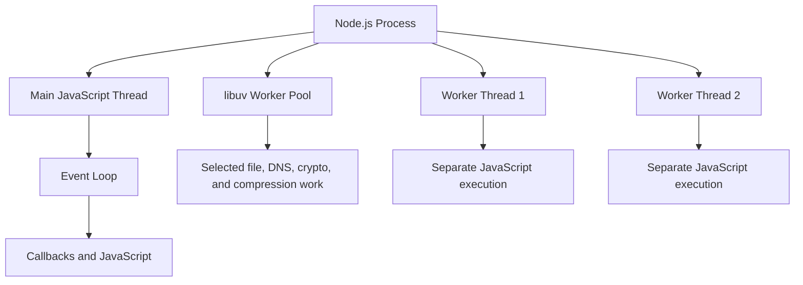

## 3. Thread-per-Request vs Event Loop Model

  -----------------------------------------------------------------------
  Thread-per-request style            Node.js event-loop style
  ----------------------------------- -----------------------------------
  A request may be handled by a       Many I/O operations can be in
  dedicated or pooled thread          progress while one main JS thread
                                      handles ready callbacks

  More threads can increase memory    A small number of threads can serve
  and scheduling overhead             many I/O-heavy connections

  Shared memory may require           Main-thread JavaScript runs one
  synchronization                     callback at a time

  Can be suitable for many workloads  Especially suitable for I/O-heavy
                                      workloads
  -----------------------------------------------------------------------

This is a conceptual comparison. Modern servers in many languages use
asynchronous I/O and thread pools too. Do not assume all non-Node.js
servers use one thread per request.

## 4. What is concurrency?

Concurrency means multiple tasks make progress during overlapping
periods.

For example:

-   Request A waits for a database.
-   Request B waits for an external API.
-   Request C is ready to execute JavaScript.

Node.js can start A and B, then execute C while A and B are waiting.

## 5. What is parallelism?

Parallelism means multiple tasks are actually executing at the same
time, usually on multiple CPU cores or execution units.

Concurrency and parallelism are related but not the same.

``` text
Concurrency:
Task A: [Start ---- waiting ---- finish]
Task B:      [Start ---- waiting ---- finish]
Task C:           [Run]

Parallelism:
Core 1: [Task A executing]
Core 2: [Task B executing]
```

## 6. When should you use Worker Threads?

Use Worker Threads when you need CPU-intensive JavaScript to run away
from the main Event Loop.

Examples:

-   CPU-heavy calculations.
-   Image or data transformations implemented in JavaScript.
-   Parsing large datasets.
-   Computational workloads that can be divided into independent tasks.

Do not create a new Worker Thread for every tiny function call. Worker
creation and message passing have costs. For repeated tasks, a worker
pool is often a better design.

## 7. Interview Questions

**Q1. Is Node.js single-threaded?**

JavaScript application code normally runs on one main thread by default,
but Node.js also uses other threads internally and supports Worker
Threads.

**Q2. What is the difference between concurrency and parallelism?**

Concurrency means tasks make progress over overlapping periods.
Parallelism means tasks execute simultaneously.

**Q3. Why can Node.js handle many connections?**

Because it uses non-blocking I/O and an Event Loop rather than requiring
a separate JavaScript thread for every connection.

### Quick Revision

-   Main JavaScript thread = one callback at a time.
-   Concurrency does not require parallel execution.
-   Node.js uses OS I/O and a worker pool for selected operations.
-   Worker Threads allow parallel JavaScript execution.

------------------------------------------------------------------------

# 1-9. How the Event Loop Works

**Level:** Intermediate\
**Priority:** P0

## 1. What is the Event Loop?

The Event Loop is the mechanism that allows Node.js to coordinate
asynchronous operations and execute their callbacks when they are ready.

Think of it as a coordinator:

-   JavaScript starts an asynchronous operation.
-   Node.js or the operating system handles the waiting or background
    work.
-   When the operation completes, its callback becomes eligible to run.
-   The Event Loop helps schedule that callback.

The Event Loop does not make a long synchronous JavaScript function run
in the background.

## 2. Simple Analogy: A Restaurant

Imagine a restaurant:

-   The main JavaScript thread is the waiter taking and delivering
    orders.
-   The kitchen and other services handle work that takes time.
-   The waiter does not stand still waiting for every dish to cook.
-   When an order is ready, the waiter handles the next required action.

This is only an analogy. Real Node.js scheduling is more complex.

## 3. The Event Loop Phases

A simplified list of important phases:

1.  **Timers:** Runs eligible `setTimeout()` and `setInterval()`
    callbacks.
2.  **Pending callbacks:** Runs certain system-level I/O callbacks
    deferred to a later loop iteration.
3.  **Idle and prepare:** Internal libuv phases.
4.  **Poll:** Retrieves and processes many I/O events.
5.  **Check:** Runs `setImmediate()` callbacks.
6.  **Close callbacks:** Runs certain close-related callbacks, such as
    socket close events.

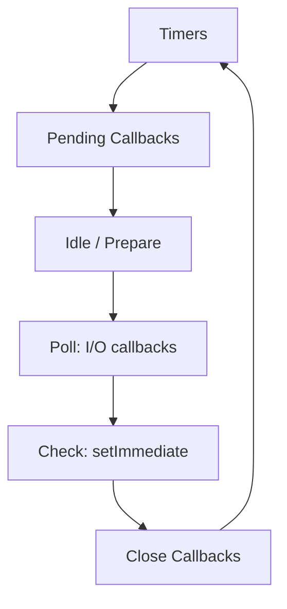

This diagram is simplified. The Event Loop may wait in the poll phase,
and the exact timing of callbacks depends on the work scheduled and
runtime version.

## 4. Timers Are Thresholds, Not Exact Appointments

``` js
setTimeout(() => {
  console.log("Timer callback");
}, 1000);
```

This means the callback becomes eligible after the threshold has passed.
It does not guarantee execution at exactly 1,000 milliseconds.

If the Event Loop is busy, the callback may run later.

## 5. `setTimeout()` vs `setImmediate()`

  -----------------------------------------------------------------------
  `setTimeout(callback, delay)`       `setImmediate(callback)`
  ----------------------------------- -----------------------------------
  Runs after a timer threshold        Runs in the check phase
  becomes eligible                    

  Useful for scheduling after a       Useful for scheduling work after
  minimum delay                       the current poll phase

  Exact timing is not guaranteed      Ordering depends on the context in
                                      which it is scheduled
  -----------------------------------------------------------------------

Example:

``` js
setTimeout(() => {
  console.log("timeout");
}, 0);

setImmediate(() => {
  console.log("immediate");
});
```

When scheduled from the main module, do not depend on a fixed order
between these two callbacks. When scheduled inside an I/O callback,
`setImmediate()` is generally executed before a timer scheduled for zero
delay in that context.

## 6. `process.nextTick()` and Promise Microtasks

`process.nextTick()` schedules a callback to run after the current
JavaScript operation completes and before the Event Loop continues to
another phase.

Promise callbacks and `queueMicrotask()` use the microtask queue.

``` js
console.log("Start");

process.nextTick(() => {
  console.log("nextTick");
});

Promise.resolve().then(() => {
  console.log("Promise");
});

console.log("End");
```

In a typical CommonJS example, the output is:

``` text
Start
End
nextTick
Promise
```

Do not use `process.nextTick()` recursively without a good reason. A
continuously refilled next-tick queue can prevent the Event Loop from
moving forward.

## 7. Important: The Event Loop Can Be Blocked

``` js
console.log("Start");

const end = Date.now() + 3000;

while (Date.now() < end) {
  // Blocks the main JavaScript thread for about 3 seconds.
}

console.log("End");
```

During the loop, the main JavaScript thread cannot process other
callbacks.

This is why you should avoid:

-   Large synchronous loops in request handlers.
-   Synchronous file operations in high-traffic request paths.
-   Very expensive JSON transformations on huge objects.
-   CPU-heavy work on the main thread.

## 8. What happens when an API request arrives?

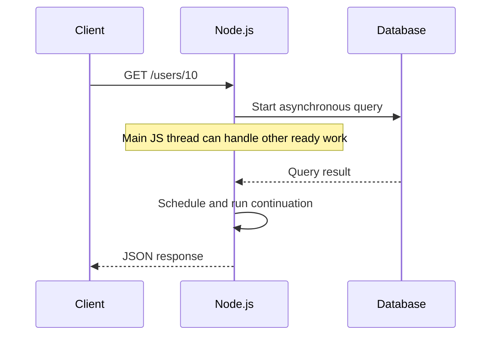

## 9. Node.js 20+ Timer Note

Starting with libuv 1.45.0, used by Node.js 20 and later, timers run
after the poll phase in each Event Loop iteration rather than both
before and after poll as in earlier behavior. This can affect some
`setImmediate()` and timer ordering examples.

For interviews, understand the phases and the principles. Do not
memorize one output from a timing example as a universal rule.

## 10. Interview Questions

**Q1. What is the Event Loop?**

It coordinates asynchronous operations and executes callbacks when they
are ready, allowing Node.js to perform non-blocking I/O.

**Q2. Does `setTimeout(fn, 0)` execute immediately?**

No. It schedules a callback after a minimum timer threshold, and the
callback runs when the Event Loop can process it.

**Q3. Is `process.nextTick()` an Event Loop phase?**

No. It uses a separate next-tick queue that Node.js processes between
operations.

**Q4. Can CPU-heavy JavaScript block Node.js?**

Yes. A long synchronous task blocks the main JavaScript thread and
delays other callbacks.

### Quick Revision

-   Event Loop = asynchronous work coordinator.
-   Poll = important I/O event phase.
-   Check = `setImmediate()` callbacks.
-   Timers = `setTimeout()` and `setInterval()` callbacks.
-   `process.nextTick()` is not an Event Loop phase.
-   Long synchronous JavaScript blocks the main thread.

------------------------------------------------------------------------

# 1-10. Asynchronous I/O, Callbacks, Promises, and Async/Await

**Level:** Intermediate\
**Priority:** P0

## 1. What is I/O?

I/O means Input/Output. It describes communication with something
outside the current JavaScript computation.

Examples:

-   Reading a file.
-   Writing a file.
-   Sending a network request.
-   Querying a database.
-   Communicating with another service.

## 2. Blocking vs Non-Blocking

**Blocking:** The current JavaScript execution must wait for the
operation to finish before moving to the next line.

**Non-blocking:** The operation is started, and JavaScript can continue
doing other work while the operation is in progress.

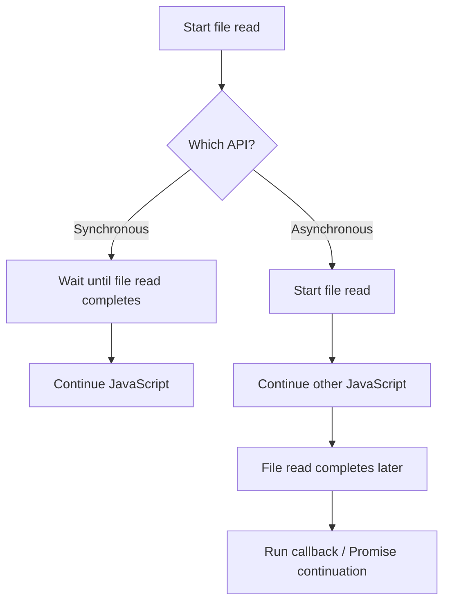

## 3. Synchronous Example

``` js
import { readFileSync } from "node:fs";

console.log("Start");

const content = readFileSync("./notes.txt", "utf8");

console.log(content);
console.log("End");
```

The main JavaScript thread waits for the file read to finish.

## 4. Asynchronous Callback Example

``` js
import { readFile } from "node:fs";

console.log("Start");

readFile("./notes.txt", "utf8", (error, content) => {
  if (error) {
    console.error(error);
    return;
  }

  console.log(content);
});

console.log("End");
```

The callback follows the common Node.js error-first convention:

``` js
(error, result) => {}
```

If the operation succeeds, `error` is usually `null`. If it fails, the
error is provided.

## 5. What is a Promise?

A Promise represents the eventual result of an asynchronous operation.

A Promise can be:

-   **Pending:** Still waiting.
-   **Fulfilled:** Completed successfully.
-   **Rejected:** Failed.

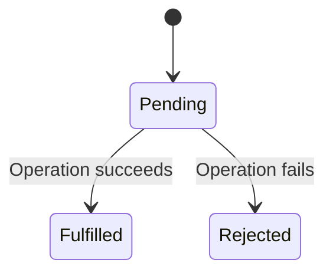

Example:

``` js
import { readFile } from "node:fs/promises";

readFile("./notes.txt", "utf8")
  .then((content) => {
    console.log(content);
  })
  .catch((error) => {
    console.error("Could not read file:", error.message);
  });
```

## 6. What is Async/Await?

`async/await` is syntax that makes Promise-based code easier to read.

-   An `async` function always returns a Promise.
-   `await` pauses that async function until the Promise settles.
-   `await` does not block the entire Node.js process while an
    asynchronous operation is waiting.
-   `await` does not magically turn a synchronous operation into an
    asynchronous one.

``` js
import { readFile } from "node:fs/promises";

async function readNotes() {
  try {
    const content = await readFile("./notes.txt", "utf8");
    console.log(content);
  } catch (error) {
    console.error("Read failed:", error.message);
  }
}

readNotes();
```

## 7. Sequential vs Concurrent Work

Sequential:

``` js
const user = await getUser();
const orders = await getOrders();
```

The second operation starts after the first one completes.

Concurrent:

``` js
const [user, orders] = await Promise.all([
  getUser(),
  getOrders()
]);
```

Both operations are started without waiting for the other to finish.
`Promise.all()` rejects if one of its input Promises rejects.

Use concurrent work only when the operations are independent and it is
safe to run them together.

## 8. Which approach should you use?

  -----------------------------------------------------------------------
  Approach                            Use when
  ----------------------------------- -----------------------------------
  Callback                            Working with callback-based APIs or
                                      event listeners

  Promise                             Composing asynchronous operations

  `async/await`                       Writing readable sequential or
                                      structured asynchronous logic

  Synchronous API                     Small startup scripts or tasks
                                      where blocking is acceptable
  -----------------------------------------------------------------------

For most new application code, Promise-based APIs and `async/await` are
convenient choices.

## 9. Common Mistakes

**Mistake 1: Forgetting `await`**

``` js
const userPromise = getUser();
console.log(userPromise); // A Promise, not necessarily the user object
```

**Mistake 2: Not handling a rejection**

``` js
const user = await getUser(); // May throw if the Promise rejects
```

Handle errors with `try/catch` or an appropriate `.catch()`.

**Mistake 3: Using `Promise.all()` for dependent operations**

If the second operation needs the result of the first, run them
sequentially.

**Mistake 4: Thinking async/await makes CPU-heavy code non-blocking**

A large synchronous loop inside an async function still blocks the
JavaScript thread.

## 10. Interview Questions

**Q1. What is non-blocking I/O?**

It allows the application to start an I/O operation and continue other
work instead of synchronously waiting for the operation to finish.

**Q2. Does `async` make a function run on another thread?**

No. It changes how the function works with Promises. It does not
automatically create another thread.

**Q3. What does `Promise.all()` do?**

It waits for all supplied Promises to fulfill, or rejects as soon as one
rejects.

### Quick Revision

-   I/O = communication with files, networks, databases, and other
    systems.
-   Blocking operations hold up the current JavaScript thread.
-   Callbacks are functions called after an operation or event.
-   Promises represent eventual results.
-   `async/await` makes Promise-based code easier to read.
-   `Promise.all()` is useful for independent concurrent tasks.

------------------------------------------------------------------------

# 1-11. Streams, Buffers, and Backpressure

**Level:** Intermediate\
**Priority:** P1

## 1. What is a Buffer?

A Buffer represents a fixed-length sequence of bytes.

Computers store files and network data as bytes. A Buffer helps Node.js
work with binary data.

Examples:

-   Images.
-   PDFs.
-   Audio and video.
-   Network packets.
-   Encrypted data.
-   File contents.

``` js
import { Buffer } from "node:buffer";

const message = Buffer.from("Hello Node.js", "utf8");

console.log(message);
console.log(message.toString("utf8"));
console.log(message.length);
```

The string is encoded into bytes. Converting the Buffer back to text
requires the correct encoding.

### Important Buffer methods

``` js
import { Buffer } from "node:buffer";

const safeBuffer = Buffer.alloc(10);
const fromText = Buffer.from("Hello");
const fromArray = Buffer.from([65, 66, 67]);

console.log(fromText.toString("utf8")); // Hello
console.log(fromArray.toString("utf8")); // ABC
```

Prefer `Buffer.alloc()` when you need a zero-filled Buffer. Be careful
with uninitialized memory APIs and never expose uninitialized bytes.

## 2. What is a Stream?

A Stream lets you process data piece by piece instead of loading the
entire data source into memory at once.

Imagine downloading a large video:

-   Without streaming, you may try to load the whole file into memory.
-   With streaming, the file can be processed in smaller chunks.

## 3. Four Main Stream Types

  Stream type   Purpose                            Example
  ------------- ---------------------------------- ------------------
  Readable      Provides data                      Reading a file
  Writable      Receives data                      Writing a file
  Duplex        Reads and writes                   A network socket
  Transform     Reads, changes, and outputs data   Compression

## 4. Visual: Stream Pipeline


## 5. Practical Example: Copy a Large File

``` js
import { createReadStream, createWriteStream } from "node:fs";

const source = createReadStream("./large-video.mp4");
const destination = createWriteStream("./copy-video.mp4");

source.pipe(destination);

destination.on("finish", () => {
  console.log("File copied successfully");
});

source.on("error", (error) => {
  console.error("Read error:", error);
});

destination.on("error", (error) => {
  console.error("Write error:", error);
});
```

`pipe()` connects a readable stream to a writable stream and helps
manage flow control.

For production code, `stream/promises` and `pipeline()` are often a
safer way to connect streams because errors and cleanup can be handled
across the pipeline.

``` js
import { createReadStream, createWriteStream } from "node:fs";
import { pipeline } from "node:stream/promises";

await pipeline(
  createReadStream("./large-video.mp4"),
  createWriteStream("./copy-video.mp4")
);

console.log("Copy complete");
```

## 6. What is Backpressure?

Backpressure happens when data is produced faster than the destination
can consume it.

Example:

-   A readable stream produces 100 MB of data per second.
-   A writable stream can save only 20 MB per second.
-   The producer must slow down or the internal buffer may keep growing.


In a writable stream, `write()` returning `false` means you should wait
for the `'drain'` event before continuing to write more data.

``` js
import { createWriteStream } from "node:fs";

const output = createWriteStream("./output.txt");

const canContinue = output.write("First chunk\n");

if (!canContinue) {
  output.once("drain", () => {
    console.log("Writable stream is ready for more data");
  });
}
```

This is a small illustration. A complete producer must pause when
`write()` returns `false`, resume on `'drain'`, and handle errors and
stream closure.

## 7. Why use Streams?

-   Reduce memory pressure for large data.
-   Process files in chunks.
-   Handle network data progressively.
-   Build upload and download pipelines.
-   Compress or transform data while it moves.

## 8. When should you use Buffer vs Stream?

  -----------------------------------------------------------------------
  Buffer                              Stream
  ----------------------------------- -----------------------------------
  Represents bytes in memory          Processes data over time

  Useful for small or already-loaded  Useful for large or continuous data
  binary data                         

  May hold the complete data          Can process chunks

  Example: an image already loaded in Example: streaming a large video
  memory                              file
  -----------------------------------------------------------------------

## 9. Interview Questions

**Q1. What is a Buffer?**

A Buffer is a fixed-length sequence of bytes used to handle binary data.

**Q2. What is a Stream?**

A Stream is an abstraction for processing data incrementally.

**Q3. What is backpressure?**

It is a flow-control situation where a producer is faster than a
consumer. The system must slow or pause production to avoid excessive
buffering.

**Q4. What does `pipe()` do?**

It connects a readable stream to a writable stream and manages data
flow, including backpressure.

### Quick Revision

-   Buffer = bytes in memory.
-   Stream = data processed in chunks.
-   Readable = source.
-   Writable = destination.
-   Duplex = both directions.
-   Transform = changes data.
-   Backpressure = producer must respect consumer speed.

------------------------------------------------------------------------

# 1-12. Node.js Modules: IIFE, CommonJS, and ESM

**Level:** Intermediate\
**Priority:** P0

## 1. What is a Module?

A module is a reusable unit of code.

A project may contain:

-   A user module.
-   An authentication module.
-   A payment module.
-   A database module.
-   A logging module.

Modules help organize code, reuse functionality, and avoid placing the
entire application in one file.

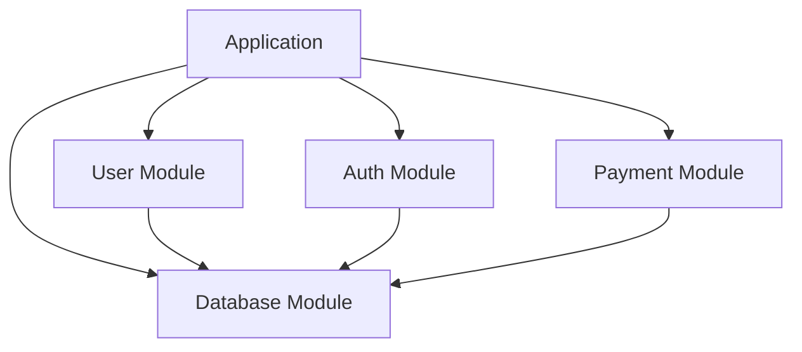

## 2. Why do modules matter?

Without modules, a large application becomes difficult to understand and
maintain.

Modules provide:

-   Separation of concerns.
-   Reusability.
-   Better organization.
-   Controlled exports.
-   Easier testing.
-   Clear dependencies.

------------------------------------------------------------------------

## 3. IIFE: Immediately Invoked Function Expression

**IIFE** means Immediately Invoked Function Expression.

It is a function expression that is defined and executed immediately.

``` js
(function () {
  const secret = "private value";

  console.log("IIFE executed");
})();
```

Output:

``` text
IIFE executed
```

### Why was IIFE useful?

Before modern JavaScript modules became widely available, developers
often used IIFEs to create a private scope and avoid polluting the
global namespace.

``` js
const counter = (function () {
  let count = 0;

  return {
    increment() {
      count++;
    },
    getValue() {
      return count;
    }
  };
})();

counter.increment();
counter.increment();

console.log(counter.getValue()); // 2
```

The `count` variable cannot be accessed directly from outside the IIFE.

### When is IIFE used today?

-   Small one-time initialization.
-   Creating a local scope.
-   Avoiding global variables in older scripts.
-   Some specialized initialization patterns.

**Important:** Modern JavaScript modules already provide file-level
scope. You usually do not need an IIFE just to protect variables in a
modern Node.js module.

------------------------------------------------------------------------

## 4. The Node.js CommonJS Module Wrapper

CommonJS is the original module system used by Node.js.

When Node.js loads a CommonJS module, it wraps the module code in a
function. A simplified conceptual wrapper looks like this:

``` js
(function (exports, require, module, __filename, __dirname) {
  // Your CommonJS module code runs here.
});
```

This wrapper helps provide:

-   Module-level scope.
-   Access to `require`.
-   Access to `module`.
-   Access to `exports`.
-   Access to `__filename` and `__dirname`.

This is a conceptual representation of the CommonJS wrapper, not code
you normally write yourself.

## 5. CommonJS Example

Create `math.cjs`:

``` js
function add(a, b) {
  return a + b;
}

function subtract(a, b) {
  return a - b;
}

module.exports = {
  add,
  subtract
};
```

Create `app.cjs`:

``` js
const math = require("./math.cjs");

console.log(math.add(10, 5));
console.log(math.subtract(10, 5));
```

Run:

``` bash
node app.cjs
```

Output:

``` text
15
5
```

### Important CommonJS terms

  Term               Meaning
  ------------------ --------------------------------------------------
  `require()`        Loads a CommonJS module
  `module.exports`   Value exposed by the module
  `exports`          Initially a reference to `module.exports`
  `__filename`       Absolute filename of the current CommonJS module
  `__dirname`        Directory name of the current CommonJS module

## 6. `exports` vs `module.exports`

This is a very important concept.

Initially:

``` js
exports === module.exports // true
```

Both refer to the same object.

This works:

``` js
exports.add = (a, b) => a + b;
```

It modifies the object that `module.exports` references.

This does not work as many beginners expect:

``` js
exports = {
  add: (a, b) => a + b
};
```

It only reassigns the local `exports` variable. It does not replace
`module.exports`.

Use this when you want to replace the entire exported value:

``` js
module.exports = {
  add: (a, b) => a + b
};
```

## 7. What is an Alias?

An alias is another name for an existing value.

You can rename a CommonJS import while destructuring:

``` js
const { readFile: read } = require("node:fs");

read("./notes.txt", "utf8", (error, content) => {
  if (error) {
    console.error(error);
    return;
  }

  console.log(content);
});
```

Here, `readFile` is imported under the local name `read`.

You can also export a function under a different name in ESM:

``` js
function add(a, b) {
  return a + b;
}

export { add as sum };
```

Then import it:

``` js
import { sum } from "./math.js";

console.log(sum(2, 3));
```

Do not confuse an alias with a separate copy of the function. It is
another name used to access the exported value.

------------------------------------------------------------------------

## 8. What is ESM?

**ESM** means ECMAScript Modules. It is the official JavaScript module
standard.

It uses:

-   `import` to bring values into a module.
-   `export` to make values available to other modules.

Create `math.js`:

``` js
export function add(a, b) {
  return a + b;
}

export function subtract(a, b) {
  return a - b;
}
```

Create `app.js`:

``` js
import { add, subtract } from "./math.js";

console.log(add(10, 5));
console.log(subtract(10, 5));
```

If your `package.json` contains:

``` json
{
  "type": "module"
}
```

Node.js treats `.js` files in that package as ESM.

## 9. Named Export vs Default Export

### Named exports

``` js
export function login() {
  return "Logged in";
}

export function logout() {
  return "Logged out";
}
```

Import with the exported names:

``` js
import { login, logout } from "./auth.js";
```

You can rename a named import:

``` js
import { login as signIn } from "./auth.js";
```

### Default export

``` js
export default function createUser() {
  return { id: 1, name: "Alex" };
}
```

Import it with any local name:

``` js
import makeUser from "./user.js";
```

A module can have one default export. It can also have named exports.

## 10. CommonJS vs ESM

  -----------------------------------------------------------------------
  CommonJS                            ESM
  ----------------------------------- -----------------------------------
  Uses `require()`                    Uses `import`

  Uses `module.exports` or `exports`  Uses `export`

  Traditional Node.js module system   Standard JavaScript module system

  Commonly loaded through the         Uses the ESM loader
  CommonJS loader                     

  `.cjs` is always CommonJS           `.mjs` is always ESM

  `.js` follows package module        `.js` follows package module
  configuration and Node's            configuration and Node's
  module-detection rules              module-detection rules
  -----------------------------------------------------------------------

### How do you choose the module type?

Use explicit configuration in a project:

**ESM project:**

``` json
{
  "type": "module"
}
```

**CommonJS project:**

``` json
{
  "type": "commonjs"
}
```

You can also use:

-   `.mjs` for ESM.
-   `.cjs` for CommonJS.

For new projects, ESM is a good default because it is the standard
JavaScript module format. However, you will still encounter CommonJS in
existing Node.js projects and packages.

## 11. `__dirname` in ESM

CommonJS provides `__dirname` and `__filename`. ESM does not provide
those CommonJS variables directly.

Use `import.meta.url` with Node.js utilities:

``` js
import path from "node:path";
import { fileURLToPath } from "node:url";

const __filename = fileURLToPath(import.meta.url);
const __dirname = path.dirname(__filename);

console.log(__filename);
console.log(__dirname);
```

## 12. When should you use which system?

-   Use ESM for new JavaScript projects unless a dependency or tool
    requires something else.
-   Understand CommonJS because many existing Node.js codebases use it.
-   Avoid mixing module systems unnecessarily.
-   Be explicit about module type in `package.json`.

## 13. Interview Questions

**Q1. What is a module?**

A module is a reusable and organized unit of code that can expose
selected functionality to other modules.

**Q2. What is IIFE?**

An Immediately Invoked Function Expression is a function expression that
executes immediately after it is defined.

**Q3. What is the CommonJS module wrapper?**

Node.js conceptually wraps each CommonJS module in a function that
provides module-scoped variables such as `require`, `module`, `exports`,
`__filename`, and `__dirname`.

**Q4. What is the difference between `exports` and `module.exports`?**

`exports` initially references `module.exports`. Adding properties
through `exports` works, but reassigning `exports` does not replace the
value exported by the module. Assign to `module.exports` to replace the
exported value.

**Q5. What is ESM?**

ESM is the standard JavaScript module system based on `import` and
`export`.

### Quick Revision

-   Module = reusable unit of code.
-   IIFE = function expression executed immediately.
-   CommonJS = `require()` and `module.exports`.
-   ESM = `import` and `export`.
-   `exports` initially references `module.exports`.
-   `.mjs` = ESM; `.cjs` = CommonJS.
-   `.js` depends on package configuration and Node.js module-detection
    rules.

------------------------------------------------------------------------

# 1-13. Built-in Modules: fs, path, os, and HTTP

**Level:** Beginner to Intermediate\
**Priority:** P0

## 1. What are Built-in Modules?

Built-in modules are modules that ship with Node.js. You can use them
without installing a third-party package.

Examples:

  Module           Purpose
  ---------------- ------------------------------------
  `node:fs`        Work with files and directories
  `node:path`      Work with file and directory paths
  `node:os`        Get operating-system information
  `node:http`      Create HTTP servers and clients
  `node:https`     Work with HTTPS
  `node:events`    Work with EventEmitter
  `node:stream`    Work with streams
  `node:buffer`    Work with bytes
  `node:crypto`    Cryptographic utilities
  `node:process`   Access process information

The `node:` prefix explicitly identifies a Node.js built-in module.

------------------------------------------------------------------------

## 2. File System: `node:fs`

The File System module allows Node.js to interact with files and
directories.

Common use cases:

-   Read a configuration file.
-   Write logs.
-   Create directories.
-   Upload or process files.
-   Read data from a local file.

### Read a file using Promises

``` js
import { readFile } from "node:fs/promises";

try {
  const content = await readFile("./notes.txt", "utf8");
  console.log(content);
} catch (error) {
  console.error("Could not read file:", error.message);
}
```

### Write a file

``` js
import { writeFile } from "node:fs/promises";

await writeFile("./output.txt", "Hello from Node.js!", "utf8");

console.log("File written");
```

### Create a directory

``` js
import { mkdir } from "node:fs/promises";

await mkdir("./uploads", { recursive: true });
```

### Important `fs` APIs

  API                     Purpose
  ----------------------- --------------------------------
  `readFile()`            Read an entire file
  `writeFile()`           Write or replace file contents
  `appendFile()`          Add content to a file
  `mkdir()`               Create a directory
  `readdir()`             Read directory entries
  `rename()`              Rename or move a file
  `unlink()`              Remove a file
  `stat()`                Get file information
  `createReadStream()`    Read a file as a stream
  `createWriteStream()`   Write a file as a stream

**Important:** `readFile()` loads the complete file into memory. For
very large files, prefer streams.

------------------------------------------------------------------------

## 3. Path: `node:path`

Different operating systems use different path separators and path
conventions. The `path` module helps construct and inspect paths safely.

``` js
import path from "node:path";

const filePath = path.join("uploads", "images", "photo.png");

console.log(filePath);
console.log(path.basename(filePath));
console.log(path.extname(filePath));
console.log(path.dirname(filePath));
```

Important methods:

  Method              Purpose
  ------------------- -------------------------------
  `path.join()`       Joins path segments
  `path.resolve()`    Creates an absolute path
  `path.basename()`   Gets the final path component
  `path.dirname()`    Gets the directory portion
  `path.extname()`    Gets the file extension
  `path.parse()`      Returns path components

### `join()` vs `resolve()`

``` js
import path from "node:path";

console.log(path.join("folder", "file.txt"));
console.log(path.resolve("folder", "file.txt"));
```

-   `join()` combines path segments.
-   `resolve()` produces an absolute path using the current working
    directory or an absolute segment.

Do not assume `path.join()` validates a path for security. When
accepting a user-supplied filename, validate it and prevent path
traversal.

------------------------------------------------------------------------

## 4. OS: `node:os`

The OS module provides information about the operating system and
machine.

``` js
import os from "node:os";

console.log("Platform:", os.platform());
console.log("Architecture:", os.arch());
console.log("CPUs:", os.cpus().length);
console.log("Total memory:", os.totalmem());
console.log("Free memory:", os.freemem());
console.log("Home directory:", os.homedir());
```

Use cases:

-   Collect machine information.
-   Build system utilities.
-   Inspect available resources.
-   Make environment-aware decisions.

For determining a useful parallelism count, Node.js also provides
`os.availableParallelism()`.

------------------------------------------------------------------------

## 5. HTTP: `node:http`

The HTTP module allows you to create an HTTP server without using
Express or NestJS.

### Create a basic server

Create `server.js`:

``` js
import { createServer } from "node:http";

const server = createServer((req, res) => {
  if (req.method === "GET" && req.url === "/") {
    res.writeHead(200, {
      "Content-Type": "application/json"
    });

    res.end(JSON.stringify({
      message: "Hello from raw Node.js"
    }));

    return;
  }

  res.writeHead(404, {
    "Content-Type": "application/json"
  });

  res.end(JSON.stringify({
    message: "Route not found"
  }));
});

server.listen(3000, "127.0.0.1", () => {
  console.log("Server running at http://127.0.0.1:3000");
});
```

Run:

``` bash
node server.js
```

Open:

``` text
http://127.0.0.1:3000
```

### What happens in this code?

1.  `createServer()` creates an HTTP server.
2.  The callback receives a request and response object.
3.  `req.method` identifies the HTTP method.
4.  `req.url` identifies the requested URL.
5.  `res.writeHead()` sends the status code and headers.
6.  `res.end()` finishes the response.
7.  `server.listen()` starts listening for connections.

### Raw Node.js vs Express

  -----------------------------------------------------------------------
  Raw Node.js HTTP                    Express
  ----------------------------------- -----------------------------------
  Uses `node:http` directly           Builds on Node.js HTTP capabilities

  You handle routing and many details Provides convenient routing and
  yourself                            middleware

  Good for understanding HTTP         Convenient for building APIs
  fundamentals                        

  More manual code                    Less repetitive code
  -----------------------------------------------------------------------

Learning raw HTTP helps you understand what frameworks simplify. You do
not need to build every production API without a framework.

## 6. Interview Questions

**Q1. What are Node.js built-in modules?**

Modules included with Node.js that can be imported without installing a
third-party package.

**Q2. What is the purpose of `path`?**

It provides cross-platform utilities for constructing and inspecting
file-system paths.

**Q3. What does `createServer()` do?**

It creates an HTTP server that can receive requests and send responses.

### Quick Revision

-   `fs` = file system.
-   `path` = path utilities.
-   `os` = operating-system information.
-   `http` = HTTP server and client functionality.
-   Built-in modules do not need separate npm installation.

------------------------------------------------------------------------

# 1-14. Process, Environment Variables, and Runtime Configuration

**Level:** Intermediate\
**Priority:** P1

## 1. What is a Process?

A process is a running instance of a program.

When you run:

``` bash
node server.js
```

the operating system starts a Node.js process to execute the program.

Node.js provides the global `process` object, which exposes information
and controls related to the current process.

## 2. Useful Process Properties

``` js
console.log("Process ID:", process.pid);
console.log("Node version:", process.version);
console.log("Platform:", process.platform);
console.log("Current directory:", process.cwd());
console.log("Arguments:", process.argv);
console.log("Environment:", process.env.NODE_ENV);
```

  Property                  Purpose
  ------------------------- ---------------------------------------
  `process.pid`             Process ID
  `process.version`         Node.js version
  `process.platform`        Operating-system platform
  `process.arch`            CPU architecture
  `process.cwd()`           Current working directory
  `process.argv`            Command-line arguments
  `process.env`             Environment variables
  `process.memoryUsage()`   Process memory information
  `process.exitCode`        Exit code used when the process exits

## 3. What are Environment Variables?

Environment variables are configuration values provided to a running
process.

Examples:

-   `PORT`
-   `NODE_ENV`
-   `DATABASE_URL`
-   `REDIS_URL`
-   `JWT_SECRET`

Why use them?

Different environments need different configuration:

-   Development.
-   Testing.
-   Staging.
-   Production.

You should not hardcode production passwords, API keys, or database
credentials in source code.

## 4. Read an Environment Variable

``` js
const port = Number(process.env.PORT ?? 3000);

console.log(`Server will use port ${port}`);
```

Run with a variable:

``` bash
PORT=5000 node server.js
```

PowerShell:

``` powershell
$env:PORT="5000"
node server.js
```

Environment variables are strings. Validate and convert them before
using them.

## 5. Example: Validate Required Configuration

``` js
const databaseUrl = process.env.DATABASE_URL;

if (!databaseUrl) {
  throw new Error("DATABASE_URL is required");
}

console.log("Database configuration found");
```

For local development, a `.env` file and a package such as `dotenv` can
be useful. Do not commit real secrets to Git. In production, use your
hosting platform's secret or environment configuration facility.

## 6. Graceful Shutdown

A server should close resources cleanly when it receives a shutdown
signal.

``` js
import { createServer } from "node:http";

const server = createServer((req, res) => {
  res.end("OK");
});

server.listen(3000);

process.on("SIGTERM", () => {
  console.log("Shutdown signal received");

  server.close(() => {
    console.log("HTTP server closed");
    process.exitCode = 0;
  });
});
```

A real application may also need to stop accepting background jobs,
close database connections, flush logs, and enforce a shutdown timeout.

Prefer setting `process.exitCode` and allowing the process to finish
cleanly over calling `process.exit()` too early.

## 7. Interview Questions

**Q1. What is `process.env`?**

It is an object containing environment variables available to the
current Node.js process.

**Q2. Why should secrets be stored in environment variables or a secret
manager?**

This separates sensitive configuration from source code and makes it
easier to configure different environments securely.

**Q3. What is graceful shutdown?**

It is the process of stopping new work and closing active resources
cleanly before a program exits.

### Quick Revision

-   Process = running program.
-   `process` = information and controls for the current Node.js
    process.
-   `process.env` = environment variables.
-   Do not commit secrets.
-   Graceful shutdown closes active resources before exit.

------------------------------------------------------------------------

# 1-15. Error Handling in Node.js

**Level:** Intermediate\
**Priority:** P1

## 1. What is Error Handling?

Error handling is the process of detecting, reporting, and responding to
failures.

Examples:

-   File does not exist.
-   Database connection fails.
-   API request times out.
-   User input is invalid.
-   A network connection closes unexpectedly.

A reliable backend should expect failures and handle them intentionally.

## 2. Synchronous Error: `try/catch`

``` js
try {
  const result = JSON.parse("{ invalid json }");
  console.log(result);
} catch (error) {
  console.error("Parsing failed:", error.message);
}
```

## 3. Promise Error: `.catch()`

``` js
import { readFile } from "node:fs/promises";

readFile("./missing.txt", "utf8")
  .then((content) => {
    console.log(content);
  })
  .catch((error) => {
    console.error("File read failed:", error.message);
  });
```

## 4. Async/Await Error: `try/catch`

``` js
import { readFile } from "node:fs/promises";

async function loadFile() {
  try {
    const content = await readFile("./notes.txt", "utf8");
    return content;
  } catch (error) {
    console.error("Could not load file:", error.message);
    throw error;
  }
}
```

If you catch an error and rethrow it, the caller can decide how to
respond.

## 5. Callback Error Handling

Many Node.js callback APIs use the error-first convention:

``` js
import { readFile } from "node:fs";

readFile("./notes.txt", "utf8", (error, content) => {
  if (error) {
    console.error(error);
    return;
  }

  console.log(content);
});
```

## 6. EventEmitter Error Handling

``` js
import { EventEmitter } from "node:events";

const emitter = new EventEmitter();

emitter.on("error", (error) => {
  console.error("Emitter error:", error.message);
});

emitter.emit("error", new Error("Connection failed"));
```

## 7. Error Categories

  -----------------------------------------------------------------------
  Error type              Example                 Typical response
  ----------------------- ----------------------- -----------------------
  Validation error        Invalid email           Return a client error

  Authentication error    Missing or invalid      Return an
                          credentials             authentication response

  Authorization error     User lacks permission   Deny the operation

  Not found               Requested record does   Return not found
                          not exist               

  Dependency error        Database unavailable    Retry when safe or
                                                  return a service error

  Programming error       Accessing an undefined  Fix the code and
                          value                   investigate
  -----------------------------------------------------------------------

## 8. Important Production Practices

-   Validate external input.
-   Use centralized error handling in web frameworks.
-   Log useful context without logging passwords, tokens, or other
    secrets.
-   Do not expose stack traces to public API clients.
-   Set appropriate HTTP status codes.
-   Handle expected failures close to where they occur.
-   Monitor unexpected failures.
-   Shut down safely when the process is in an unknown or corrupted
    state.

## 9. Why not rely on `uncaughtException`?

`uncaughtException` is a last-resort process-level event. It is not a
safe replacement for normal error handling.

An uncaught exception may leave the application in an unknown state. Use
the event for final synchronous cleanup and controlled shutdown, not to
continue normal application work as if nothing happened.

## 10. Interview Questions

**Q1. How do you handle errors in async/await?**

Use `try/catch` around awaited operations and decide whether to handle
or rethrow the error.

**Q2. What is an error-first callback?**

A callback pattern where the first argument represents an error and the
later arguments contain successful results.

**Q3. Should a server continue normally after an uncaught exception?**

Usually no. The application may be in an inconsistent state. It should
perform appropriate cleanup and be restarted by a process manager or
deployment platform.

### Quick Revision

-   Use `try/catch` for synchronous exceptions and awaited Promise
    failures.
-   Use `.catch()` for Promise chains.
-   Check error arguments in callback APIs.
-   Listen for EventEmitter `'error'` events when appropriate.
-   Do not treat `uncaughtException` as ordinary error handling.

------------------------------------------------------------------------

# 1-16. Worker Threads and Child Processes

**Level:** Intermediate to Advanced\
**Priority:** P1

## 1. Why do we need them?

Node.js normally executes application JavaScript on one main thread.
CPU-heavy work on that thread can delay the Event Loop.

Worker Threads and child processes provide ways to move work away from
the main thread or into another process.

They solve different problems.

## 2. Worker Threads

A Worker Thread runs JavaScript in a separate thread within the same
Node.js process.

Use it for CPU-intensive JavaScript tasks that can benefit from parallel
execution.

Examples:

-   Large calculations.
-   Data transformations.
-   CPU-heavy parsing.
-   Independent computational jobs.

### Main thread: `main.js`

``` js
import { Worker } from "node:worker_threads";

const worker = new Worker(
  new URL("./worker.js", import.meta.url),
  {
    workerData: 10
  }
);

worker.on("message", (result) => {
  console.log("Result from worker:", result);
});

worker.on("error", (error) => {
  console.error("Worker failed:", error);
});

worker.on("exit", (code) => {
  console.log("Worker exited with code:", code);
});
```

### Worker file: `worker.js`

``` js
import { parentPort, workerData } from "node:worker_threads";

let result = 1;

for (let i = 1; i <= workerData; i++) {
  result *= i;
}

parentPort.postMessage(result);
```

The example calculates a factorial in a worker. For very large
factorials, JavaScript's normal number precision is insufficient; this
example is only to demonstrate communication.

## 3. How Worker Threads communicate

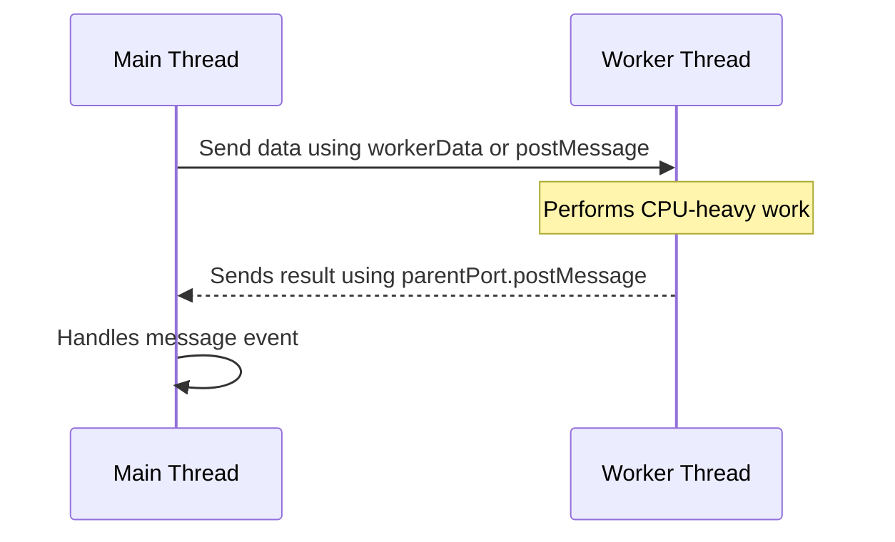

## 4. Child Processes

A child process is a separate operating-system process started by the
current process.

It has its own process identity and memory space.

Use child processes when you need to:

-   Run another program or command.
-   Isolate a task in a separate process.
-   Run another Node.js script.
-   Communicate with a separate process.

### Example: Run a command using `spawn()`

``` js
import { spawn } from "node:child_process";

const child = spawn("node", ["--version"]);

child.stdout.on("data", (data) => {
  console.log(`Output: ${data}`);
});

child.stderr.on("data", (data) => {
  console.error(`Error output: ${data}`);
});

child.on("error", (error) => {
  console.error("Could not start process:", error);
});

child.on("close", (code) => {
  console.log("Child process closed with code:", code);
});
```

## 5. `spawn()` vs `exec()` vs `fork()`

  API            Typical use
  -------------- -----------------------------------------------------------
  `spawn()`      Start a process and work with its output streams
  `exec()`       Run a command through a shell and collect buffered output
  `execFile()`   Run an executable directly without a shell by default
  `fork()`       Start another Node.js process with an IPC channel

**Security warning:** Avoid passing untrusted input into shell commands.
Shell execution can create command-injection vulnerabilities. Prefer
`spawn()` or `execFile()` with an executable and separate argument array
when possible.

## 6. Worker Threads vs Child Processes

  -----------------------------------------------------------------------
  Worker Threads                      Child Processes
  ----------------------------------- -----------------------------------
  Separate JavaScript threads         Separate OS processes

  Within the same Node.js process     Separate process with its own
                                      memory

  Can share memory through            Communicate using IPC, pipes, or
  SharedArrayBuffer when designed     other mechanisms
  carefully                           

  Useful for CPU-heavy JavaScript     Useful for running commands or
                                      isolated applications

  Lower process isolation             Stronger process-level isolation
  -----------------------------------------------------------------------

## 7. When should you use them?

-   Use the main Event Loop for ordinary request handling and
    non-blocking I/O.
-   Use Worker Threads for CPU-intensive JavaScript.
-   Use child processes to run external programs or isolate work in
    another process.
-   Use a job queue when work must be processed asynchronously and
    managed independently of the request lifecycle.

### Quick Revision

-   Worker Thread = another JavaScript thread in the same process.
-   Child Process = a separate operating-system process.
-   Worker Threads are useful for CPU-heavy JavaScript.
-   Child processes are useful for running programs and process
    isolation.

------------------------------------------------------------------------

# 1-17. Cluster, Profiling, and Memory Optimization

**Level:** Advanced\
**Priority:** P2

## Part A --- Cluster

### 1. What is Cluster?

The Node.js Cluster module allows multiple Node.js processes to run
server workers that can share a server port.

This can help use multiple CPU cores for incoming connections.

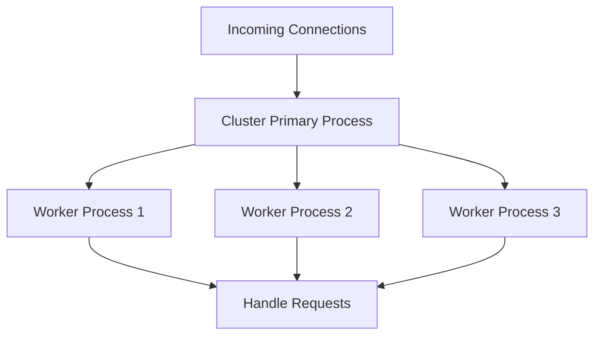

Each worker is a separate process with its own memory and V8 instance.

### 2. When is Cluster useful?

-   When you want multiple Node.js processes to serve incoming
    connections.
-   When you need to use more than one CPU core for a server workload.
-   When process-level isolation is useful.

### 3. Cluster vs Worker Threads

  -----------------------------------------------------------------------
  Cluster                             Worker Threads
  ----------------------------------- -----------------------------------
  Multiple processes                  Multiple threads

  Separate process memory             Same process, separate JavaScript
                                      execution threads

  Process-level isolation             Thread-level parallelism

  Workers can share a server port     Designed for parallel JavaScript
                                      tasks and message passing
  -----------------------------------------------------------------------

Cluster is not automatically required for every Node.js application.
Containers, process managers, and orchestration platforms are also
common ways to run multiple application instances.

------------------------------------------------------------------------

## Part B --- Profiling and Performance

### 1. What is Profiling?

Profiling means measuring an application's behavior to discover where
time or resources are being used.

Do not optimize based only on guesses.

Common performance problems:

-   Slow database queries.
-   Slow external APIs.
-   Event Loop blocking.
-   Expensive JSON parsing or serialization.
-   Memory leaks.
-   Too much logging.
-   Unnecessary repeated computation.
-   Poor caching or inefficient algorithms.

### 2. Basic Performance Measurement

``` js
import { performance } from "node:perf_hooks";

const start = performance.now();

// Work being measured
const result = Array.from({ length: 100_000 }, (_, index) => index)
  .reduce((sum, value) => sum + value, 0);

const end = performance.now();

console.log("Result:", result);
console.log(`Duration: ${(end - start).toFixed(2)} ms`);
```

This measures a small section of code. It does not automatically tell
you the cause of a production slowdown.

### 3. Useful Node.js profiling tools

  Tool                      Purpose
  ------------------------- -----------------------------------------
  `node --inspect`          Debug with developer tools
  `node --cpu-prof`         Generate a CPU profile
  `node --heap-prof`        Generate a heap profile
  `node --prof`             Generate a V8 profiler log
  `node:perf_hooks`         Measure performance
  `process.memoryUsage()`   Inspect process memory
  V8 heap snapshots         Investigate retained JavaScript objects

Example:

``` bash
node --cpu-prof server.js
```

For debugging:

``` bash
node --inspect server.js
```

Do not expose the inspector port publicly in production.

### 4. Monitor Event Loop Delay

``` js
import { monitorEventLoopDelay } from "node:perf_hooks";

const histogram = monitorEventLoopDelay({
  resolution: 20
});

histogram.enable();

setInterval(() => {
  console.log({
    meanMs: Number(histogram.mean / 1e6).toFixed(2),
    maxMs: Number(histogram.max / 1e6).toFixed(2)
  });

  histogram.reset();
}, 5000);
```

This is a basic diagnostic example. Production monitoring should use
appropriate metrics collection and lifecycle management.

------------------------------------------------------------------------

## Part C --- Memory Management

### 1. How does Node.js manage JavaScript memory?

V8 manages the JavaScript heap and automatically reclaims many objects
that are no longer reachable through garbage collection.

But garbage collection cannot reclaim an object that your application
still references.

### 2. What is a Memory Leak?

A memory leak occurs when memory is retained even though the application
no longer needs it.

Common causes:

-   Unbounded caches.
-   Global arrays that keep growing.
-   Event listeners that are never removed.
-   Timers that are never cleared.
-   References retained by closures.
-   Streams or resources that are not closed.
-   Large objects kept in memory unnecessarily.

### 3. Example of a Potential Memory Leak

``` js
const cache = [];

setInterval(() => {
  cache.push({
    createdAt: Date.now(),
    data: "This object stays referenced"
  });
}, 1000);
```

The array keeps growing. The garbage collector cannot remove those
objects because the `cache` array still references them.

A real cache should have a defined size, expiration policy, and cleanup
strategy.

### 4. Inspect Memory Usage

``` js
console.log(process.memoryUsage());
```

Important fields:

  -----------------------------------------------------------------------
  Field                               Meaning
  ----------------------------------- -----------------------------------
  `rss`                               Total resident memory used by the
                                      process

  `heapTotal`                         V8 heap memory allocated

  `heapUsed`                          V8 heap memory currently used

  `external`                          Memory used by native objects
                                      associated with JavaScript objects

  `arrayBuffers`                      Memory used by ArrayBuffers and
                                      related buffers
  -----------------------------------------------------------------------

### 5. Practical Memory Optimization

-   Avoid storing unlimited data in memory.
-   Use streams for large files.
-   Set cache limits and expiration.
-   Remove event listeners when they are no longer needed.
-   Clear timers when appropriate.
-   Close database connections and file handles.
-   Avoid unnecessary copies of large Buffers.
-   Take heap snapshots when investigating leaks.
-   Measure before and after optimization.

### 6. Event Loop and Memory Are Related

A large amount of memory allocation can increase garbage-collection
work. Long garbage-collection pauses or CPU-heavy operations can affect
application responsiveness.

Memory optimization should therefore be based on measurements, not
random code changes.

## Interview Questions

**Q1. What is the Cluster module?**

It allows multiple Node.js worker processes to share a server port and
distribute incoming connections.

**Q2. What is profiling?**

Profiling measures runtime behavior, such as CPU usage, execution time,
memory, or Event Loop delay, to help find bottlenecks.

**Q3. What is a memory leak?**

A memory leak occurs when objects remain referenced and consume memory
even though the application no longer needs them.

**Q4. Does garbage collection prevent all memory leaks?**

No. Garbage collection can reclaim unreachable objects, but it cannot
reclaim objects that remain reachable through application references.

### Quick Revision

-   Cluster = multiple Node.js processes.
-   Worker Threads = parallel JavaScript threads.
-   Profiling = measure before optimizing.
-   `process.memoryUsage()` = inspect process memory.
-   Heap snapshots = investigate retained objects.
-   Memory leaks often come from references that are never released.

------------------------------------------------------------------------

## Common Mistakes

  -----------------------------------------------------------------------
  Mistake                             Correct understanding
  ----------------------------------- -----------------------------------
  Node.js is a programming language   Node.js is a JavaScript runtime

  Node.js is completely               Main JavaScript normally runs on
  single-threaded                     one thread, but the runtime uses
                                      other threads and OS facilities

  Every async operation uses the      Some use OS asynchronous I/O;
  worker pool                         selected operations use the worker
                                      pool

  Async/await creates a new thread    It works with Promises; it does not
                                      automatically create a thread

  `setTimeout(fn, 0)` runs            It runs after a timer threshold
  immediately                         when the Event Loop can process it

  EventEmitter listeners are          They run synchronously by default
  automatically asynchronous          

  `exports = {}` replaces             It only reassigns the local
  `module.exports`                    `exports` variable

  A Buffer and a Stream are the same  Buffer represents bytes; Stream
                                      processes data over time

  `readFile()` is best for every file Streams are often better for large
  size                                files

  Node.js is always faster than other Performance depends on workload and
  server runtimes                     implementation

  `uncaughtException` is normal error It is a last-resort mechanism;
  handling                            clean up and shut down safely

  Cluster and Worker Threads are      Cluster uses processes; Worker
  identical                           Threads use threads
  -----------------------------------------------------------------------

------------------------------------------------------------------------

## Module Review

By now, you should understand the following flow:

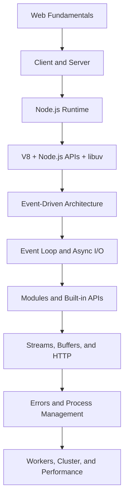

### Can you explain these without looking?

-   What is Node.js?
-   How does Node.js execute JavaScript?
-   What does V8 do?
-   What does libuv do?
-   What is the Event Loop?
-   What happens when a file is read asynchronously?
-   Why can CPU-heavy JavaScript block an API server?
-   What is the difference between concurrency and parallelism?
-   What is the difference between CommonJS and ESM?
-   Why are Streams useful for large files?
-   What is backpressure?
-   What is the difference between Worker Threads and child processes?
-   How would you investigate high memory usage?

------------------------------------------------------------------------

## Interview Questions

### Basic

**1. What is Node.js?**

Node.js is an open-source, cross-platform JavaScript runtime environment
that runs JavaScript outside the browser.

**2. Is Node.js a programming language?**

No. JavaScript is the language; Node.js is the runtime.

**3. What is npm?**

npm is the package manager commonly used to install and manage
JavaScript packages in Node.js projects.

**4. What is V8?**

V8 is the JavaScript engine used by Node.js to execute JavaScript.

**5. What is an API?**

An API is a defined interface through which software components
communicate.

### Intermediate

**6. Why is Node.js called event-driven?**

Because it responds to events such as incoming requests, completed I/O
operations, and emitted application events.

**7. What is non-blocking I/O?**

It allows an application to start an I/O operation and continue other
work while waiting for the result.

**8. What is the Event Loop?**

It coordinates asynchronous operations and executes callbacks when they
are ready.

**9. What is the difference between `setImmediate()` and
`setTimeout()`?**

`setImmediate()` runs in the check phase after poll. `setTimeout()` runs
after a timer threshold becomes eligible. Their order depends on the
context.

**10. What is the difference between CommonJS and ESM?**

CommonJS uses `require()` and `module.exports`; ESM uses `import` and
`export`.

**11. What is the difference between `exports` and `module.exports`?**

`exports` initially references `module.exports`. Reassigning `exports`
does not replace the exported value.

**12. Why are Streams useful?**

They allow data to be processed incrementally and help avoid loading an
entire large data source into memory.

### Advanced

**13. Why can a CPU-heavy task make a Node.js API slow?**

Because synchronous CPU-heavy JavaScript blocks the main JavaScript
thread and prevents the Event Loop from running other callbacks.

**14. How do Worker Threads help?**

They run JavaScript in separate threads, allowing CPU-heavy tasks to
execute away from the main Event Loop thread.

**15. What is backpressure?**

It is a flow-control mechanism that prevents a fast producer from
overwhelming a slower consumer.

**16. What is the difference between Worker Threads and Cluster?**

Worker Threads run multiple JavaScript threads within a process. Cluster
uses multiple Node.js processes.

**17. How would you investigate a memory leak?**

Monitor memory over time, reproduce the behavior, take heap snapshots,
compare retained objects, inspect caches and listeners, and identify
references that should have been released.

**18. How would you investigate a slow API?**

Measure request latency, inspect database and external-service timings,
check CPU profiles and Event Loop delay, review synchronous work, and
inspect memory and logs.

------------------------------------------------------------------------

## Practice Exercises

Complete these exercises in order. Do not only read the solution---write
the code yourself.

### Beginner

-   [ ] Create a Node.js project and run a JavaScript file.
-   [ ] Print Node.js and npm versions.
-   [ ] Create a basic HTTP server using `node:http`.
-   [ ] Return JSON from a `GET /users` route.
-   [ ] Return a `404` response for an unknown route.
-   [ ] Read a text file using `node:fs/promises`.
-   [ ] Write data to a file.
-   [ ] Build a small utility using `node:path`.

### Intermediate

-   [ ] Create two modules and import/export functions using ESM.
-   [ ] Create a small CommonJS example using `require()` and
    `module.exports`.
-   [ ] Demonstrate the difference between `exports` and
    `module.exports`.
-   [ ] Create an EventEmitter with two listeners.
-   [ ] Compare synchronous and asynchronous file reads.
-   [ ] Use `Promise.all()` to run two independent asynchronous
    operations.
-   [ ] Copy a large file using Streams.
-   [ ] Demonstrate how a slow synchronous loop blocks a timer.
-   [ ] Read configuration from environment variables.
-   [ ] Add graceful shutdown to an HTTP server.

### Advanced

-   [ ] Move a CPU-heavy calculation into a Worker Thread.
-   [ ] Start a child process using `spawn()`.
-   [ ] Inspect process memory using `process.memoryUsage()`.
-   [ ] Generate a CPU profile.
-   [ ] Monitor Event Loop delay.
-   [ ] Create a bounded in-memory cache and implement expiration.
-   [ ] Explain when Cluster is useful and compare it with Worker
    Threads.

------------------------------------------------------------------------

## Quick Revision Sheet

  Concept            Remember this
  ------------------ ---------------------------------------------
  Node.js            JavaScript runtime
  V8                 Executes JavaScript
  libuv              Event Loop and asynchronous I/O support
  Event Loop         Coordinates callbacks and asynchronous work
  Non-blocking I/O   Do not synchronously wait for I/O
  Callback           Function passed to run later
  Promise            Represents an eventual result
  Async/Await        Readable syntax for Promise-based code
  EventEmitter       Emits named events and calls listeners
  CommonJS           `require()` and `module.exports`
  ESM                `import` and `export`
  IIFE               Immediately invoked function expression
  Buffer             Fixed-length bytes in memory
  Stream             Processes data incrementally
  Backpressure       Controls producer/consumer speed
  `fs`               File-system operations
  `path`             File-system path utilities
  `http`             HTTP server and client APIs
  `process.env`      Environment configuration
  Worker Threads     Parallel JavaScript execution threads
  Child Process      Separate operating-system process
  Cluster            Multiple Node.js worker processes
  Profiling          Measure performance to find bottlenecks
  Memory Leak        Unneeded objects remain referenced

------------------------------------------------------------------------

## Recommended Resources

Use official documentation as the source of truth. Tutorials are useful
for learning, but runtime behavior and API details can change between
Node.js versions.

### Official Node.js Learning Resources

1.  [Introduction to
    Node.js](https://nodejs.org/learn/getting-started/introduction-to-nodejs)
2.  [Node.js About Page](https://nodejs.org/en/about)
3.  [The Node.js Event
    Loop](https://nodejs.org/learn/asynchronous-work/event-loop-timers-and-nexttick)
4.  [Overview of Blocking vs
    Non-Blocking](https://nodejs.org/learn/asynchronous-work/overview-of-blocking-vs-non-blocking)
5.  [Don't Block the Event
    Loop](https://nodejs.org/learn/asynchronous-work/dont-block-the-event-loop)
6.  [Node.js API Documentation](https://nodejs.org/api/)
7.  [CommonJS Modules](https://nodejs.org/api/modules.html)
8.  [ECMAScript Modules](https://nodejs.org/api/esm.html)
9.  [Packages and Module System
    Rules](https://nodejs.org/api/packages.html)
10. [File System](https://nodejs.org/api/fs.html)
11. [HTTP](https://nodejs.org/api/http.html)
12. [Events](https://nodejs.org/api/events.html)
13. [Streams](https://nodejs.org/api/stream.html)
14. [Buffers](https://nodejs.org/api/buffer.html)
15. [Worker Threads](https://nodejs.org/api/worker_threads.html)
16. [Child Processes](https://nodejs.org/api/child_process.html)
17. [Cluster](https://nodejs.org/api/cluster.html)
18. [Process](https://nodejs.org/api/process.html)
19. [Performance Hooks](https://nodejs.org/api/perf_hooks.html)
20. [V8 Module](https://nodejs.org/api/v8.html)
21. [Node.js Release
    Schedule](https://nodejs.org/en/about/previous-releases)

### Final Learning Advice

Do not try to memorize all Node.js APIs in this module. Focus first on
the runtime mental model:

**JavaScript runs on the main thread. V8 executes it. Node.js provides
server-side APIs. libuv coordinates the Event Loop and selected
asynchronous operations. The operating system handles many underlying
I/O tasks.**

Once this model is clear, Express.js and NestJS become easier to
understand because you will know what the frameworks are simplifying for
you.
